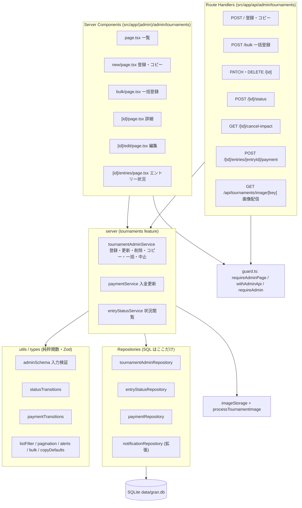
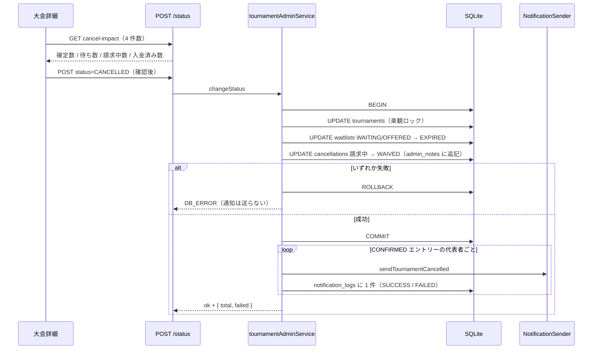
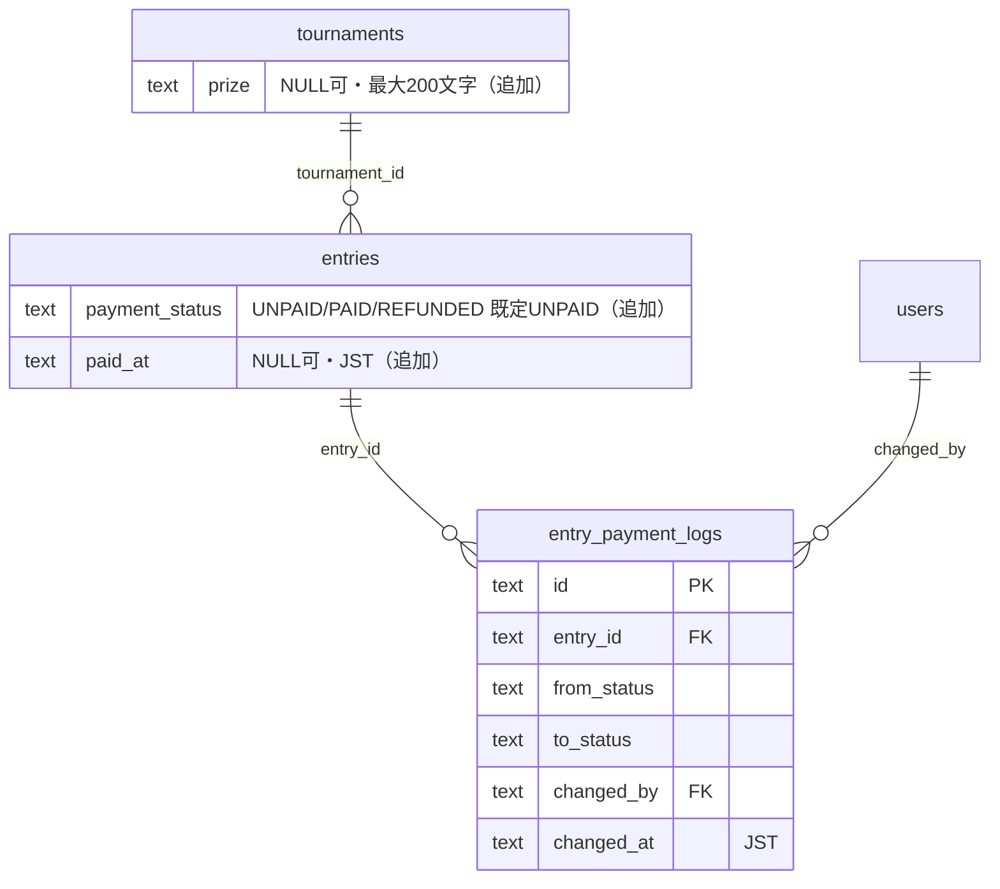
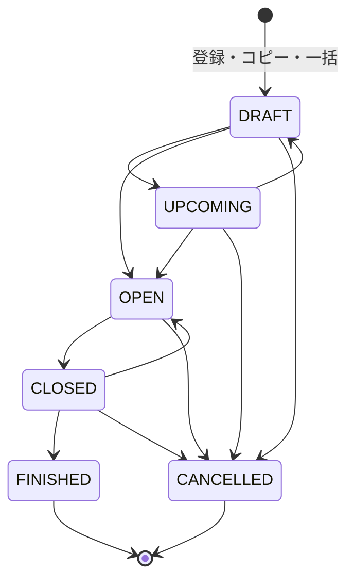
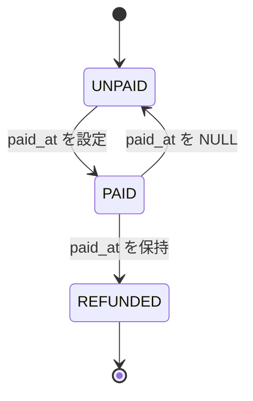

# Design Document

## Overview

管理コンソール（`/admin`）に「大会管理」を追加する。大会の一覧・登録・一括登録・編集・コピー・削除・ステータス変更・中止、大会別エントリー状況の閲覧、入金状況の更新までを対象とする（requirements.md の Requirement 1〜15）。

既存実装の次の規約に合わせる。

| 領域 | 既存の規約（参照元） | 本設計での扱い |
| --- | --- | --- |
| 認可 | `permissions.ts` の `ROLE_PERMISSIONS`、`guard.ts` の `requireAdminPage` / `withAdminApi` / `requireAdmin`。判定は毎回 DB の最新 role を参照 | 新権限 `entries.manage` を追加。ページは `requireAdminPage`、書き込みは `withAdminApi` |
| 書き込み API | トピックス管理は `/api/admin/topics` の Route Handler（multipart、`{ ok, message, fieldErrors }`） | `/api/admin/tournaments` 系 Route Handler に統一。同じ応答形を使う |
| リポジトリ | SQL はリポジトリ層に閉じ込める。`db.prepare` のバインド変数のみ。トランザクションは `db.exec("BEGIN")` / `COMMIT` / `ROLLBACK`（`reorderTopics`） | 同じ流儀で `tournamentAdminRepository` 等を追加 |
| スキーマ変更 | `applySchema` 内の `CREATE TABLE IF NOT EXISTS` と `ensureColumn`。CHECK を変えるテーブルは「改名→再作成→コピー→削除」（`inbox_notifications`） | `prize` / `payment_status` / `paid_at` は `ensureColumn`。`notification_logs` は CHECK 拡張のため再作成 |
| 画像 | `imageStorage`（`save` / `read` / `delete`）、`detectAvatarType`、`sharp` による WebP 変換（`topics/server/imageProcessor.ts`） | 同じ部品を再利用。大会用の上限 5MB の `processTournamentImage` を追加 |
| 日時 | JST 文字列。`NOW_JST`、`nowJstString`、`toJstString` | 同じ形式。日付 `YYYY-MM-DD`、時刻 `HH:mm`、日時 `YYYY-MM-DD HH:mm:ss` |
| UI | `docs/ui-design-system.md`、`components/ui/button.tsx`、`Toast.tsx`、Lucide のみ | 同じ部品を再利用。確認ダイアログ `ConfirmDialog` を共通部品として追加 |
| テスト | vitest（`GRAN_DB_PATH=:memory:`）と fast-check 4.10.2 | 純粋関数とインメモリ DB に対するプロパティテストを中心にする |

### 設計判断

1. **配置**: 管理者向けコードは `src/features/tournaments/` に `admin` 接頭辞付きで追加する（`topicAdminRepository` と同じく、機能ディレクトリ内に管理者用リポジトリを置く規約）。`src/features/admin/` にはガードとナビだけを置く現状を保つ。
2. **書き込みは Route Handler**: 要項画像の multipart 送信があり、トピックス管理と同じ方式のほうが差が少ない。入金更新も同じ方式にする。
3. **一覧のフィルタはクライアント側**: 大会数は少なく、Requirement 2.6（不正な期間でも直前の一覧を保持）をクライアント状態で素直に満たせる。フィルタ関数は純粋関数にしてテストする。
4. **エントリー状況のフィルタ・ページングはサーバー側（URL の searchParams）**: エントリー数が多くなりうるため SQL で絞り込み、20 件ずつ取得する。
5. **確定エントリー数の定義**: 要件の用語集どおり `entries.status = 'CONFIRMED'` のみを数える。ユーザー向け画面（`tournamentRepository.LIST_SELECT`）は `CONFIRMED` と `ATTENDED` を数えているため、`ATTENDED` が存在する大会で表示がずれる。SQL 断片を定数 `CONFIRMED_ENTRY_SQL` に集約し、ユーザー向けと揃える場合は 1 か所の変更で済むようにする（確認事項に記載）。
6. **楽観ロック**: 編集・ステータス変更は `updated_at` を、入金更新は `payment_status` を `UPDATE ... WHERE` 条件に含めて検証する。`updated_at` は秒精度のため、同一秒内の競合は検知できない（運営者数が少ないため許容）。
7. **管理者用の入力検証は新規スキーマ**: 既存の `tournamentCreateSchema` は `surface` 必須・個人戦の `gender_division` 必須だが、要件では両方が Optional_Fields である。管理者用に別の Zod スキーマを定義し、既存スキーマ（シード用）には触れない。
8. **画像 URL**: `image_url` には `/api/tournaments/image/{保存キー}` を保存する。専用の列を増やさず、キーは URL から厳密な正規表現で取り出す。正規表現に一致しない値（シードの外部 URL など）は「管理対象外画像」として扱い、Image_Storage の削除対象にしない。
9. **通知**: `notification_logs` へのスタブ送信（既存方針）。中止通知用に `delivery_type` へ `TOURNAMENT_CANCELLED` を追加するため、テーブルを再作成する。

## Architecture



### 権限

`AdminPermission` に `entries.manage` を追加し、`ROLE_PERMISSIONS.ADMIN` にのみ含める。

| 操作 | 必要権限 | 備考 |
| --- | --- | --- |
| 大会一覧・詳細・エントリー状況の閲覧 | `entries.view` | ADMIN・OPERATOR |
| 大会の登録・編集・削除・コピー・一括登録・ステータス変更・中止 | `tournaments.manage` | ADMIN のみ |
| 入金状況の更新 | `entries.manage` | ADMIN のみ |

- ページ: `requireAdminPage("entries.view")`（登録・編集・一括登録ページは `requireAdminPage("tournaments.manage")`）。未ログインは `/login`、権限不足は 404（既存の挙動）。
- Route Handler: `withAdminApi("tournaments.manage" | "entries.manage", ...)`。未ログインは 401、権限不足は 403。ハンドラ本体の実行前に判定する。
- `entryStatusService.getEntryStatusView` は内部でも `requireAdmin("entries.view")` を呼ぶ（Requirement 14.26、14.27）。ページ以外から呼ばれても権限なしではデータを返さない。
- `navConfig.ts` の `tournaments` 項目は `implemented: true` にする。`permission` は `entries.view` のまま。

### URL 構成

| URL | 内容 |
| --- | --- |
| `/admin/tournaments` | 一覧（Requirement 2） |
| `/admin/tournaments/new` | 登録。`?copyFrom={id}` でコピー作成（Requirement 3、8） |
| `/admin/tournaments/bulk` | 一括登録（Requirement 9） |
| `/admin/tournaments/{id}` | 詳細・ステータス変更・中止・削除（Requirement 6、7、10、11） |
| `/admin/tournaments/{id}/edit` | 編集（Requirement 5） |
| `/admin/tournaments/{id}/entries` | エントリー状況・入金更新（Requirement 14、15） |

`{id}` が UUID 形式でない場合、または大会が存在しない場合は `notFound()`（Requirement 5.9、8.9、14.5）。

## Components and Interfaces

### ファイル構成（追加・変更）

```
src/lib/db.ts                                          変更: prize / payment_status / paid_at / entry_payment_logs / notification_logs 再作成、applySchema を export
src/features/admin/types/permissions.ts                変更: "entries.manage" を追加
src/features/admin/utils/permissions.ts                変更: ADMIN に entries.manage を追加
src/features/admin/utils/navConfig.ts                  変更: tournaments を implemented: true
src/features/notifications/server/notificationRepository.ts   変更: TOURNAMENT_CANCELLED、status / errorMessage の任意引数
src/features/entries/server/actions.ts                 変更: submitWaitlistAction に大会ステータス検証を追加（Requirement 7.12）

src/features/tournaments/
  types/adminTournament.ts            AdminTournament、入力型、一覧行、詳細統計、エラー型
  types/adminSchema.ts                管理者用 Zod スキーマ（登録・更新・一括）
  types/entryStatus.ts                エントリー状況の DTO
  utils/statusTransitions.ts          大会ステータス遷移表（純粋）
  utils/paymentTransitions.ts         入金遷移表と更新計画（純粋）
  utils/listFilter.ts                 一覧の並び順・絞り込み・期間検証（純粋）
  utils/alerts.ts                     警告判定、定員比率、参加費合計、確認要否（純粋）
  utils/bulk.ts                       一括登録の展開と重複検出（純粋）
  utils/copyDefaults.ts               コピー初期値（純粋）
  utils/adminImageUrl.ts              image_url の生成と保存キー抽出（純粋）
  utils/pagination.ts                 20 件ページング（純粋。data/utils/pagination.ts と同じ形なら再利用）
  server/imageProcessor.ts            processTournamentImage（5MB、PNG/JPEG/WebP）
  server/tournamentForm.ts            multipart から検証前オブジェクトを取り出す（topicForm.ts と同形）
  server/tournamentAdminRepository.ts 大会の SELECT / INSERT / UPDATE / DELETE、統計、中止時の一括更新
  server/tournamentAdminService.ts    画像・トランザクション・通知の調停
  server/entryStatusRepository.ts     件数・エントリー・キャンセル待ち・キャンセル一覧
  server/entryStatusService.ts        権限検証つきの閲覧データ組み立て
  server/paymentRepository.ts         入金更新と entry_payment_logs
  server/paymentService.ts            入金更新の調停
  components/admin/…                  下記 UI 部品

src/components/ui/ConfirmDialog.tsx   共通の確認ダイアログ

src/app/(admin)/admin/tournaments/…   ページ（上記 URL 構成）
src/app/api/admin/tournaments/…       Route Handler
src/app/api/tournaments/image/[key]/route.ts   画像配信
```

### 型の要点（`types/adminTournament.ts`）

```ts
export type PaymentStatus = "UNPAID" | "PAID" | "REFUNDED";

// tournaments 1 行（管理者向け）。既存 Tournament に prize / surface / seriesId / genderDivision を加えたもの。
export interface AdminTournament extends Tournament {
  prize: string | null;
  surface: "HARD" | "CLAY" | "ARTIFICIAL_GRASS" | "OTHER" | null;
  seriesId: string | null;
  genderDivision: "MEN" | "WOMEN" | "MIXED" | null;
}

// 検証済み・正規化済みの保存用入力（Requirement 3 の項目）
export interface TournamentInput {
  title: string; eventDate: string; category: TournamentCategory; tier: TournamentTier;
  venue: string; capacity: number; entryFee: number; startTime: string;
  entryStartAt: string; entryEndAt: string;           // "YYYY-MM-DD HH:mm:00"
  description: string | null; endTime: string | null; prize: string | null;
  courtInfo: string | null; teamSizeMin: number | null; teamSizeMax: number | null;
  alertThreshold: number | null; surface: AdminTournament["surface"];
  seriesId: string | null; genderDivision: AdminTournament["genderDivision"];
}

export type FieldErrors = Partial<Record<keyof TournamentInput | "image" | "form", string>>;

export type ServiceResult<T = unknown> =
  | { ok: true; data: T; warning?: string }
  | { ok: false; code: ErrorCode; message: string; fieldErrors?: FieldErrors };

export type ErrorCode =
  | "VALIDATION" | "NOT_FOUND" | "CONFLICT_STALE" | "FORBIDDEN_TRANSITION"
  | "LOCKED_FIELD" | "CAPACITY_BELOW_CONFIRMED" | "ALREADY_UPDATED"
  | "HAS_ENTRIES" | "HAS_COPIES" | "NOT_DRAFT" | "IMAGE" | "DB_ERROR";
```

HTTP 変換: `VALIDATION`・`IMAGE` は 400（画像のサイズ超過は 413、形式違反は 415。`processTopicImage` と同じ）、`NOT_FOUND` は 404、`CONFLICT_STALE`・`FORBIDDEN_TRANSITION`・`LOCKED_FIELD`・`CAPACITY_BELOW_CONFIRMED`・`HAS_ENTRIES`・`HAS_COPIES`・`NOT_DRAFT` は 409、`ALREADY_UPDATED` は 200（通知として返す、Requirement 15.19）、`DB_ERROR` は 500。

### 純粋関数

**`statusTransitions.ts`**

```ts
export const ALLOWED_STATUS_TRANSITIONS: Record<TournamentStatus, readonly TournamentStatus[]> = {
  DRAFT: ["UPCOMING", "OPEN", "CANCELLED"],
  UPCOMING: ["DRAFT", "OPEN", "CANCELLED"],
  OPEN: ["CLOSED", "CANCELLED"],
  CLOSED: ["OPEN", "FINISHED", "CANCELLED"],
  FINISHED: [],
  CANCELLED: [],
};
export function allowedNextStatuses(from: TournamentStatus): readonly TournamentStatus[];
export function canTransition(from: TournamentStatus, to: TournamentStatus): boolean; // 同一ステータスは false
export function missingRequiredFields(t: Partial<AdminTournament>): string[];          // OPEN 遷移の検証用（Requirement 6.7）
```

**`paymentTransitions.ts`**

```ts
export const ALLOWED_PAYMENT_TRANSITIONS: Record<PaymentStatus, readonly PaymentStatus[]> = {
  UNPAID: ["PAID"], PAID: ["UNPAID", "REFUNDED"], REFUNDED: [],
};
export type PaidAtMode = "SET_NOW" | "CLEAR" | "KEEP";
export type PaymentPlan =
  | { kind: "INVALID_VALUE" }
  | { kind: "STALE" }
  | { kind: "NOOP" }
  | { kind: "FORBIDDEN_TRANSITION" }
  | { kind: "ENTRY_STATUS_BLOCKED" }
  | { kind: "APPLY"; paidAt: PaidAtMode };

export function planPaymentUpdate(input: {
  entryStatus: EntryStatus; current: PaymentStatus; expectedFrom: PaymentStatus; to: unknown;
}): PaymentPlan;
export function allowedPaymentActions(current: PaymentStatus, entryStatus: EntryStatus): PaymentStatus[]; // UI の操作要素
```

`planPaymentUpdate` の判定順は次のとおり。

1. `to` が `UNPAID` / `PAID` / `REFUNDED` 以外なら `INVALID_VALUE`（Requirement 15.30）。
2. `expectedFrom !== current` なら `STALE`（15.18）。
3. `current === to` なら `NOOP`（15.19）。
4. `to` が `ALLOWED_PAYMENT_TRANSITIONS[current]` に無ければ `FORBIDDEN_TRANSITION`（15.7、15.8）。
5. `to === "PAID"` かつ `entryStatus` が `CANCELLED` または `WAITING` なら `ENTRY_STATUS_BLOCKED`（15.15、15.17）。`CANCELLED` かつ `PAID` のエントリーから `REFUNDED` / `UNPAID` への遷移は 4 を満たせば許可される（15.16）。
6. それ以外は `APPLY`。`UNPAID→PAID` は `SET_NOW`、`PAID→UNPAID` は `CLEAR`、`PAID→REFUNDED` は `KEEP`（15.9〜15.11）。

**`adminSchema.ts`**（Zod 4。`topics/types/schema.ts` の `emptyToNull` と日時の前処理を踏襲）

- 必須項目は `trim` 後に空なら「未入力」エラー（3.6）。
- `category` は `TOURNAMENT_CATEGORIES`、`tier` は 8 値、`surface` は 4 値、`genderDivision` は 3 値の列挙（3.7、3.8、3.17、3.18）。
- `capacity` は 1〜9,999、`entryFee` は 0〜999,999 の整数、`title` は 100 文字以内、`prize` は 200 文字以内、空白のみなら `null`（3.9〜3.11、3.19、3.20）。
- `eventDate` は実在する `YYYY-MM-DD`、時刻は `HH:mm`、日時は `datetime-local`（`YYYY-MM-DDTHH:mm`）を `YYYY-MM-DD HH:mm:00` へ正規化。
- クロスフィールド検証（`superRefine`）: `endTime > startTime`（3.12）、`entryEndAt > entryStartAt`（3.13）、`entryEndAt < 開催日の翌日 00:00:00`（3.14。翌日は UTC 演算で求める）、`teamSizeMin <= teamSizeMax`（3.15）、`0 <= alertThreshold <= capacity`（3.16）。各エラーは対象項目の `path` に付け、全項目のエラーを同時に返す（3.21）。
- 正規化時に、`genderDivision` が未指定で `category` が団体戦なら `MEN` / `WOMEN` / `MIXED` を補完する（`applySchema` の既存補完と同じ対応）。
- `flattenIssues`（`topicForm.ts`）と同じ形で `{ field: message }` に平坦化する。
- 更新用は同じスキーマに `expectedUpdatedAt`（必須）を加える。コピー・登録用は `copyFromId`（任意）を加える。一括用は `common`（開催日と種目区分以外の項目）と `rows: { eventDate, category, title? }[]`（1〜50 件）を持つ。

**`listFilter.ts`**

```ts
export function sortTournaments<T extends { eventDate: string; title: string }>(rows: T[]): T[]; // 開催日降順、同日は大会名昇順
export function filterTournaments<T>(rows: T[], f: { status?: TournamentStatus; q?: string; from?: string; to?: string }): T[];
export function validateDateRange(from?: string, to?: string): string | null; // from > to で文字列を返す
```

大会名の絞り込みは `toLowerCase()` で比較する（1〜100 文字、Requirement 2.4）。

**`alerts.ts`**

```ts
export function formatCapacityRatio(confirmed: number, capacity: number): { label: string; percent: number }; // percent = floor(confirmed*100/capacity) を 0〜100 に丸める
export function totalEntryFee(entryFee: number, confirmed: number): number;
export function isDraftOverdue(t: { status; entryStartAt }, nowJst: string): boolean;                 // 11.6
export function isUnderCapacityAlert(t: { eventDate; alertThreshold }, confirmed: number, nowJst: string): boolean; // 11.7（開催日の 1 か月前の同日 00:00 以降）
export function needsFeeConfirmation(oldFee: number, newFee: number, confirmed: number): boolean;     // 5.6
```

「1 か月前の同日」は、月末（例: 3/31 の 1 か月前）が存在しない場合に前月末日へ丸める。

**`bulk.ts`**: `expandBulk(common, rows)` は各行を `TournamentInput` に展開する。`findDuplicateRows(rows)` は `(eventDate, category, title)` が重複する行の 1 始まりの行番号を返す。`copyDefaults.ts` の `buildCopyDefaults(source)` はコピー対象項目だけを引き継ぎ、開催日・開始時刻・終了時刻・受付開始・受付締切を空にする。`short_title` は引き継がない（要件に無いため `NULL`）。

**`adminImageUrl.ts`**: `toImageUrl(key)` は `/api/tournaments/image/${key}` を返す。`parseImageKey(url)` は `^/api/tournaments/image/([A-Za-z0-9_-]+\.(png|jpg|webp))$` に一致した場合のみキーを返し、それ以外は `null`（管理対象外）。

### サービス層

`tournamentAdminService` は依存を引数で差し替えられる形にする（テスト用）。

```ts
interface Deps { storage: ImageStorage; sender: NotificationSender; now: () => Date }
// 既定値は { imageStorage, stubSender, () => new Date() }

createTournament(admin, raw, file?, copyFromId?): Promise<ServiceResult<{ id: string }>>
previewBulk(admin, raw, file?): Promise<ServiceResult<{ rows: PreviewRow[] }>>
createBulk(admin, raw, file?): Promise<ServiceResult<{ ids: string[] }>>
updateTournament(admin, id, raw, file?): Promise<ServiceResult<AdminTournament>>
changeStatus(admin, id, { to, expectedStatus, expectedUpdatedAt }): Promise<ServiceResult<ChangeStatusData>>
getCancelImpact(id): CancelImpact           // 確認ダイアログ用の 4 件数
deleteTournament(admin, id): Promise<ServiceResult<{ imageWarning?: string }>>
```

```ts
interface NotificationSender {
  sendTournamentCancelled(to: { userId: string; email: string }, t: { id: string; title: string }): Promise<void>; // 失敗時は throw
}
```

実送信は未実装（既存方針）のため、`stubSender` は常に成功する。実送信を追加するときはこの実装だけを差し替える。

**画像の保存順序（Requirement 4.5、4.6、4.8、8.6、8.7、10.7）**

1. 検証（入力・画像）に失敗したら何も保存せず終了する。
2. 画像を `imageStorage.save("tournament", bytes, "webp")` で保存する（コピーは元画像を `read` して `save` で複製。一括は大会ごとに別キーで保存）。保存に失敗したら、その処理で保存済みのキーをすべて `delete` して終了する。
3. DB のトランザクションを実行する。失敗したら 2 で保存したキーをすべて `delete` し、既存の `image_url` と旧画像は変更しない。
4. 成功後に、差し替え前の旧キーを `delete` する（削除失敗は警告として返し、保存結果は維持する）。
5. 大会削除は DB 削除の成功後に画像を削除し、失敗は `imageWarning` で返す（10.8）。

**ステータス変更（Requirement 6）**

1. `canTransition(current, to)` を検証する。`FINISHED` / `CANCELLED` からの変更は専用メッセージで拒否する（6.4）。
2. `to === "OPEN"` なら `missingRequiredFields` を検証し、未保存の項目名を列挙して拒否する（6.7）。
3. `UPDATE tournaments SET status = ?, updated_at = NOW_JST WHERE id = ? AND status = ? AND updated_at = ?` を実行する。更新件数が 0 なら再読み込みが必要な旨の `CONFLICT_STALE` を返す（6.5、6.6）。
4. 成功後に `revalidatePath("/tournaments")` と `/home` を呼び、ユーザー向け一覧に反映する（6.8）。

**中止（Requirement 7）**



- 請求中は `cancellations.is_paid = 1 AND admin_status IN ('UNCONTACTED','IN_CONSULTATION')`。`admin_notes` は `COALESCE(admin_notes || char(10), '') || '[大会中止により請求を取り下げ ' || ? || ']'` で追記する（`?` は JST の `YYYY-MM-DD HH:mm`）。
- 通知の失敗は大会ステータスを巻き戻さない。失敗件数と全件数を返し、UI が表示する（7.10）。
- `payment_status` と `paid_at` には触れない（7.14）。
- 入金済み件数は `entries.status IN ('CONFIRMED','ATTENDED') AND payment_status = 'PAID'`（7.1）。1 件以上なら確認ダイアログに「返金処理は本機能では行われません」を表示する（7.13）。
- `submitWaitlistAction` に大会ステータスの検証を追加する。現状は `submitEntryAction` だけが `status !== "OPEN"` を拒否しており、キャンセル待ち登録は中止済み大会でも通る。`CANCELLED` と `DRAFT` を拒否する（7.12）。

**`paymentService.updatePayment(admin, { tournamentId, entryId, to, expectedFrom })`**

1. `withAdminApi("entries.manage")` が権限を検証済み（`requireAdmin` で DB の最新ロールを参照）。
2. `BEGIN` → `SELECT id, status, payment_status FROM entries WHERE id = ? AND tournament_id = ?`。行が無ければ `NOT_FOUND`（15.28）。
3. `planPaymentUpdate` を実行し、`APPLY` 以外はロールバックして対応するエラーまたは `ALREADY_UPDATED` を返す。
4. `UPDATE entries SET payment_status = ?, paid_at = <NOW_JST | NULL | paid_at>, updated_at = NOW_JST WHERE id = ? AND payment_status = ?`。更新件数が 0 なら `STALE`。
5. `INSERT INTO entry_payment_logs (id, entry_id, from_status, to_status, changed_by, changed_at)`（`changed_at` は `NOW_JST`）。
6. `COMMIT`。失敗時は `ROLLBACK` して `DB_ERROR`（15.21〜15.23）。成功後 `revalidatePath` はせず、クライアントが `router.refresh()` する。

**`entryStatusService.getEntryStatusView(admin?, tournamentId, query)`**

- 先頭で `requireAdmin("entries.view")`（権限エラーは `AdminAccessError`）。
- 4 つの部分（件数、エントリー一覧、キャンセル待ち一覧、キャンセル一覧）を個別に `try/catch` し、失敗した部分だけ `{ ok: false }` で返す（14.28）。
- `query` は `{ status?, payment?, q?, pageEntries, pageWaitlist, pageCancellations }`。`q` は 100 文字超でサービスが検証エラーにする（画面側でも即時に検証する、14.18）。

### リポジトリの SQL 方針

すべてバインド変数。LIKE のワイルドカードは `%`、`_`、`\` をエスケープして `ESCAPE '\'` を付ける。

```sql
-- エントリー一覧（entryStatusRepository）
SELECT e.id, e.status, e.payment_status, e.paid_at, e.is_proxy, e.applied_at,
       u.real_name, t.name AS team_name
  FROM entries e
  JOIN users u ON u.id = e.user_id
  LEFT JOIN teams t ON t.id = e.team_id
 WHERE e.tournament_id = ?
   AND (? IS NULL OR e.status = ?)
   AND (? IS NULL OR e.payment_status = ?)
   AND (? IS NULL OR u.real_name LIKE ? ESCAPE '\' OR u.kana_name LIKE ? ESCAPE '\' OR t.name LIKE ? ESCAPE '\')
 ORDER BY e.applied_at ASC, e.id ASC
 LIMIT 20 OFFSET ?;
```

- 取得列は `real_name`、`kana_name`、`team_name` に限る（`kana_name` は上の SQL の SELECT 句にも追加する）。`email`、`phone_number`、`birth_date`、`login_id` は SELECT しない（14.25）。画面に表示する個人情報は氏名と読み仮名のみ。
- キャンセル待ちは `waitlists w JOIN users u LEFT JOIN teams t ... ORDER BY w.queue_number ASC`、キャンセルは `cancellations c JOIN entries e ON e.id = c.entry_id JOIN users u LEFT JOIN teams t WHERE e.tournament_id = ? ... ORDER BY c.cancelled_at DESC, c.id DESC`。いずれも同じキーワード条件と 20 件ページングを適用する。
- 件数は `SELECT status, COUNT(*) FROM entries WHERE tournament_id = ? GROUP BY status` と `payment_status` の同様のクエリ。絞り込み条件は渡さない（14.20、14.33）。0 件の区分は 0 で補完する。
- 詳細の統計は、確定数、`waitlists.status = 'WAITING'` 件数、請求中のキャンセル件数、入金済み・未入金件数（`CONFIRMED`/`ATTENDED` のうち `payment_status` 別）を個別クエリで取得し、個別に失敗を許容する（11.8）。
- 追加インデックス: `idx_entries_tournament_payment ON entries(tournament_id, payment_status)`、`idx_entry_payment_logs_entry ON entry_payment_logs(entry_id, changed_at DESC)`。

### UI 部品

| 部品 | 種別 | 役割 |
| --- | --- | --- |
| `TournamentListView` | Client | 絞り込み状態を保持し、`filterTournaments` / `sortTournaments` を適用。768px 未満はカード、以上は表（Requirement 12.6、12.7） |
| `TournamentForm` | Client | 登録・編集・コピー共通。項目別エラー表示、入力値保持、画像プレビュー（`URL.createObjectURL`）、参加費変更時の確認ダイアログ |
| `BulkRegistrationForm` | Client | 共通項目と（開催日、種目区分）の行編集、プレビュー（`dryRun`）、確定 |
| `TournamentDetailView` | Server | 全項目、統計、警告、エントリー状況へのリンク |
| `StatusChangeControl` | Client | 許可された遷移先のみ選択肢に表示。中止選択時は `CancelConfirmDialog` |
| `CancelConfirmDialog` / `DeleteConfirmDialog` | Client | 4 件数の表示、入金済み注意文、大会名の表示 |
| `EntryStatusView` | Client | 件数、フィルタ（URL searchParams を更新）、3 つの一覧、ページャ、部分失敗の再読み込み（`router.refresh()`） |
| `PaymentUpdateControl` | Client | `entries.manage` を持つときのみ描画。確認ダイアログ → API 呼び出し → トースト |
| `ConfirmDialog`（`components/ui`） | Client | `role="dialog"`、フォーカス移動、Esc で閉じる、44px 以上のボタン、処理中の二重送信防止 |

- トーストは既存の `Toast` を使う（`durationMs` を 3,200〜5,000 に設定し、3〜10 秒の範囲に収める。Requirement 12.8）。
- 実行ボタンは、クリックハンドラの同期処理で `busy` を立てて無効化する（100ms 以内。12.9、15.27）。1 回の確認で送信するリクエストは 1 回に限る。
- 表示するテキストは React のエスケープに任せ、`dangerouslySetInnerHTML` を使わない（13.7）。
- アイコンは Lucide のみ。絵文字は使わない。数値・日時・金額には `tabular-nums` を付ける。
- コンテンツ幅は `max-w-4xl`。色・角丸・ボタンバリアントは `ui-design-system.md` のトークンに限る。

### Route Handler 一覧

| メソッド・パス | 権限 | 入力 | 主な応答 |
| --- | --- | --- | --- |
| `POST /api/admin/tournaments` | `tournaments.manage` | multipart（項目、`file?`、`copyFromId?`） | `{ ok, id }` / `{ ok:false, message, fieldErrors }` |
| `POST /api/admin/tournaments/bulk` | `tournaments.manage` | multipart（`common`、`rows`、`file?`、`dryRun`） | プレビューまたは `{ ok, ids }`、エラーは行番号つき |
| `PATCH /api/admin/tournaments/[id]` | `tournaments.manage` | multipart（項目、`expectedUpdatedAt`、`file?`） | `{ ok, tournament }` |
| `DELETE /api/admin/tournaments/[id]` | `tournaments.manage` | なし | `{ ok, warning? }` |
| `POST /api/admin/tournaments/[id]/status` | `tournaments.manage` | JSON `{ to, expectedStatus, expectedUpdatedAt }` | `{ ok, notify?: { total, failed } }` |
| `GET /api/admin/tournaments/[id]/cancel-impact` | `tournaments.manage` | なし | 4 件数 |
| `POST /api/admin/tournaments/[id]/entries/[entryId]/payment` | `entries.manage` | JSON `{ to, expectedFrom }` | `{ ok, paymentStatus, paidAt }` / `{ ok:true, alreadyUpdated:true }` |
| `GET /api/tournaments/image/[key]` | ログイン必須 | キー（`KEY_PATTERN` に一致するもの） | 画像バイト（`nosniff`、`private` キャッシュ） |

入金更新の API は 1 リクエストにつき 1 エントリーのみを受け付け、配列を受け付けない（Requirement 15.31）。

## Data Models

### スキーマ変更（`src/lib/db.ts` の `applySchema`）

```ts
ensureColumn("tournaments", "prize", "TEXT");
ensureColumn("entries", "payment_status",
  "TEXT NOT NULL DEFAULT 'UNPAID' CHECK (payment_status IN ('UNPAID','PAID','REFUNDED'))");
ensureColumn("entries", "paid_at", "TEXT");

db.exec(`
  CREATE TABLE IF NOT EXISTS entry_payment_logs (
    id          TEXT PRIMARY KEY,
    entry_id    TEXT NOT NULL REFERENCES entries(id),
    from_status TEXT NOT NULL,
    to_status   TEXT NOT NULL,
    changed_by  TEXT NOT NULL REFERENCES users(id),
    changed_at  TEXT NOT NULL
  );
`);
db.exec("CREATE INDEX IF NOT EXISTS idx_entry_payment_logs_entry ON entry_payment_logs(entry_id, changed_at DESC);");
db.exec("CREATE INDEX IF NOT EXISTS idx_entries_tournament_payment ON entries(tournament_id, payment_status);");
```

- SQLite は `ADD COLUMN` で NOT NULL に非 NULL の既定値を指定でき、既存行は `UNPAID`、`paid_at` は NULL になる（Requirement 13.13、13.14）。`ensureColumn` が列の有無を `PRAGMA table_info` で確認するため、再実行や片方の列だけが存在する場合も、存在しない列のみを追加する（13.10、13.15、13.16）。
- `PAID` ⇔ `paid_at` 非 NULL（`UNPAID` は NULL）の不変条件は、`ADD COLUMN` では他列を参照する CHECK を付けにくいため、アプリ層（`planPaymentUpdate` と `paymentRepository`）で保証する。`REFUNDED` は `paid_at` を保持してよい（14.11）。
- `entry_payment_logs.entry_id` の FK は既定の `NO ACTION`。大会削除は「エントリー 0 件」のときだけ許可するため、ログがある `entries` が `ON DELETE CASCADE` で消える経路はない。
- `ensureColumn` の失敗は例外としてそのまま呼び出し元（モジュール読み込み）へ伝わる。`ALTER TABLE ADD COLUMN` は 1 文で原子的なため、失敗時に既存データは変更されない（13.17）。
- `applySchema` は現在 `function` 宣言で非公開。旧スキーマからの移行テストのため `export` する。

**`notification_logs` の再作成**: `delivery_type` の CHECK に `'TOURNAMENT_CANCELLED'` を追加する。SQLite は CHECK を `ALTER` できないため、`inbox_notifications` の移行と同じ手順にする。`sqlite_master.sql` に `TOURNAMENT_CANCELLED` が含まれない場合のみ、トランザクション内で「改名 → 新テーブル作成 → 全列コピー → 旧テーブル削除」を行う。他のテーブルから `notification_logs` への FK は無い。

`logNotification` は `status?: "SUCCESS" | "FAILED"`、`errorMessage?: string` を任意引数に追加する（既定は従来どおり `SUCCESS`）。`NotificationType` に `TOURNAMENT_CANCELLED` を追加する。

### ER 図（追加分）



`docs/db-schema.md` の ER 図、`tournaments` の列定義（3.4）、`entries` の列定義（3.5）、`entry_payment_logs` の新規定義、追加列の説明、`notification_logs` の `delivery_type` への `TOURNAMENT_CANCELLED` 追加を更新する（Requirement 13.12、13.18、13.20）。

### 状態遷移





### 保存形式

- 日付 `YYYY-MM-DD`、時刻 `HH:mm`、受付日時 `YYYY-MM-DD HH:mm:00`（`topics` と同じ `datetime-local` 正規化）。`created_at` と `updated_at` は登録時に同じ `NOW_JST` 式で設定する（3.4）。
- 任意項目の空文字は `NULL` で保存する。
- `image_url` は `/api/tournaments/image/{key}`、`copy_from_id` は複製元の ID。コピーでは `draw_pdf_url` を `NULL` にし、エントリー等は作らない（8.4、8.5）。
- 大会削除は物理削除。`copy_from_id` を持つ大会が参照している場合と、エントリーが 1 件でもある場合は削除しない（10.5、10.6）。`tournament_matches` などの子テーブルは `ON DELETE CASCADE` のため、エントリー 0 件の `DRAFT` 大会だけが対象となり実害はない。

## Correctness Properties

*A property is a characteristic or behavior that should hold true across all valid executions of a system-essentially, a formal statement about what the system should do. Properties serve as the bridge between human-readable specifications and machine-verifiable correctness guarantees.*

プロパティ反映（Property Reflection）で、同じ検証を重ねる項目を統合した。たとえば、登録・編集・コピー・一括登録の入力検証は同一スキーマを使うためプロパティ 5 に統合した。保存と読み出しの往復、日時形式、SQL 特殊文字を含む文字列の保持（バインド変数の検証）はプロパティ 6 に統合した。権限の行列（ロール × 権限）、未ログイン、直接呼び出しの拒否はプロパティ 1 に統合した。

### Property 1: 権限判定と書き込みの拒否

*For any* ロール（`ADMIN`、`OPERATOR`、`USER`、`LEADER`、未ログイン）と権限（`entries.view`、`tournaments.manage`、`entries.manage`）の組み合わせについて、権限があるのは `ADMIN`（`entries.view` は `OPERATOR` も）だけである。また、*for any* 大会・入金の書き込み API について、必要な権限を持たない呼び出しはデータベースを一切変更せず、未ログインは認証エラー、権限不足は権限不足エラーを返す。

**Validates: Requirements 1.7, 1.8, 1.9, 14.26, 14.27, 15.1, 15.4, 15.5, 15.6**

### Property 2: 一覧の並び順

*For any* 大会の一覧について、`sortTournaments` の結果は開催日の降順であり、開催日が同一の大会は大会名の昇順である。また、元の一覧と同じ要素の並べ替えである。

**Validates: Requirements 2.2**

### Property 3: 一覧の絞り込みは全条件の論理積

*For any* 大会一覧と絞り込み条件（ステータス、大会名の一部、開催日の期間のうち任意の組み合わせ）について、`filterTournaments` の結果は、指定されたすべての条件を満たす大会の集合と一致する。大会名は大文字小文字を区別しない部分一致、期間は両端を含む。

**Validates: Requirements 2.3, 2.4, 2.5, 2.7**

### Property 4: 不正な期間の検出

*For any* 開始日と終了日の組み合わせについて、`validateDateRange` はちょうど「開始日 > 終了日」のときにエラーを返す。

**Validates: Requirements 2.6**

### Property 5: 入力検証は違反した項目をすべて同時に報告する

*For any* 大会入力（生成器が各制約を個別に破る）について、`adminSchema` が返すエラーの項目集合は、実際に制約に違反している項目の集合と一致する。違反がなければ検証は成功する。制約は、必須項目の空文字・空白のみ、種目区分・募集階級・サーフェス・性別区分の列挙、定員 1〜9,999、参加費 0〜999,999、大会名 100 文字、景品 200 文字、終了時刻 > 開始時刻、受付締切 > 受付開始、受付締切 < 開催日の翌日 0 時、チーム人数の大小、アラート閾値 0〜定員である。この検証は登録・編集・コピー・一括登録の各行で共通に使われる。

**Validates: Requirements 3.6, 3.7, 3.8, 3.9, 3.10, 3.11, 3.12, 3.13, 3.14, 3.15, 3.16, 3.17, 3.18, 3.19, 3.21, 5.4, 8.8, 9.6, 13.1**

### Property 6: 保存と読み出しの往復

*For any* 検証を通過した大会入力（`'`、`"`、`;`、`--`、`%`、`<script>`、改行、日本語を含む文字列を生成する）について、保存して読み出した大会の入力項目は、正規化後の入力と完全に一致する。日付は `YYYY-MM-DD`、時刻は `HH:mm` の形式で保存され、空白のみの景品は `NULL` になり、新しい UUID が採番され、状態未指定の登録は `DRAFT` で、`created_at` と `updated_at` は同一である。SQL 文の特殊文字を含む入力でもテーブルは破壊されず、レコード数は 1 件だけ増える。

**Validates: Requirements 3.2, 3.3, 3.4, 3.20, 4.7, 13.2, 13.3, 13.6**

### Property 7: 失敗した書き込みは何も変更しない

*For any* 大会の書き込み（登録・編集・削除・一括登録・ステータス変更）について、入力の検証に失敗した場合、または処理の途中で DB エラー（テストでは SQLite のトリガーで `RAISE(ABORT)` を発生させる）が起きた場合、`tournaments` テーブルのレコード数と全レコードの全項目値は処理前と同一であり、呼び出し元にエラーが返る。

**Validates: Requirements 3.22, 9.8, 13.4, 13.8**

### Property 8: 同一内容の編集は冪等

*For any* 既存の大会と検証を通過した更新内容について、同じ更新内容で（直前の応答の `updated_at` を使って）編集を 2 回続けて実行した後の全項目値（`updated_at` を除く）は 1 回目の実行後と同一であり、レコード数は変わらない。

**Validates: Requirements 13.5**

### Property 9: 楽観ロック

*For any* 大会について、画面表示時点の `updated_at`（編集・ステータス変更）または `status`（ステータス変更）が保存値と異なる要求は、データを変更せず、再読み込みが必要な旨のエラーを返す。

**Validates: Requirements 5.10, 6.6**

### Property 10: 更新時の制約（定員・固定項目・参加費確認）

*For any* 大会と更新内容について、次の 3 つが成り立つ。(a) 新しい定員が確定エントリー数を下回る更新は拒否され、エラーに現在の確定エントリー数が含まれる。(b) ステータスが `FINISHED` または `CANCELLED` の大会に対し、開催日・定員・参加費のいずれかを変える更新は拒否される。(c) `needsFeeConfirmation(old, new, confirmed)` は、参加費が変わり、かつ確定エントリー数が 1 以上のときちょうど真になる。

**Validates: Requirements 5.5, 5.6, 5.8**

### Property 11: ステータス遷移表

*For any* 現在のステータスと要求されたステータスの組み合わせ（同一ステータスを含む 6×6）について、`canTransition` が真になるのは遷移表（`DRAFT→UPCOMING/OPEN/CANCELLED`、`UPCOMING→DRAFT/OPEN/CANCELLED`、`OPEN→CLOSED/CANCELLED`、`CLOSED→OPEN/FINISHED/CANCELLED`）にある組み合わせだけである。`allowedNextStatuses` は遷移表と一致し、`FINISHED` と `CANCELLED` では空である。許可されない遷移の要求は `status` と `updated_at` を変更しない。

**Validates: Requirements 6.1, 6.2, 6.3, 6.4, 7.4**

### Property 12: OPEN への変更には必須項目がすべて必要

*For any* 大会について、必須項目（`image_url` を含む）に未保存（NULL または空）のものが 1 つ以上あれば、`OPEN` への変更は拒否され、エラーに未保存の項目名がすべて列挙され、ステータスは変わらない。すべてそろっていれば（遷移が許可される限り）変更できる。

**Validates: Requirements 6.7**

### Property 13: 未公開の大会はユーザー向けに出ない

*For any* ステータスが混在する大会の集合について、`listPublicTournaments` の結果に `DRAFT` の大会は含まれない。

**Validates: Requirements 6.9**

### Property 14: 中止の連鎖更新と件数

*For any* 大会の状態（エントリー、キャンセル待ち、キャンセルの任意の組み合わせ）について、中止を確定した後は、(a) ステータスが `CANCELLED`、(b) その大会の `WAITING` / `OFFERED` のキャンセル待ちが残らず `EXPIRED` になる、(c) その大会の請求中（`is_paid=1` かつ `UNCONTACTED` / `IN_CONSULTATION`）のキャンセルが残らず `WAIVED` になり、元の `admin_notes` が接頭辞として保持されたまま中止の追記が付く、(d) 他の大会と対象外の行は変化しない、(e) 全エントリーの `payment_status` と `paid_at` は変化しない。また、確認ダイアログ用の 4 件数は、定義どおりの行数（確定エントリー数、`WAITING`/`OFFERED` の待ち数、請求中キャンセル数、確定・出席済みかつ入金済みの数）と一致する。

**Validates: Requirements 7.1, 7.3, 7.5, 7.6, 7.7, 7.14**

### Property 15: 中止時の原子性と通知

*For any* 大会と通知の失敗の組み合わせ（任意の宛先の部分集合が失敗）について、(a) 通知ログは `CONFIRMED` エントリーの代表者 1 人につきちょうど 1 件で、失敗した宛先だけが `FAILED`、それ以外が `SUCCESS`、(b) 通知が失敗してもステータスは `CANCELLED` のままで、返される失敗件数と全件数がログと一致する。*For any* DB 更新の途中失敗について、ステータス・キャンセル待ち・キャンセルは中止前の状態に戻り、通知は 1 件も送られない。

**Validates: Requirements 7.8, 7.9, 7.10, 7.11**

### Property 16: 要項画像の検証

*For any* バイト列について、`processTournamentImage` が成功するのは、先頭バイトで PNG・JPEG・WebP と判定でき、かつサイズが 5,242,880 バイト以下で、画像として読み込めるときだけである。それ以外は形式エラー（415）またはサイズエラー（413）を返し、ストレージには何も保存されない。

**Validates: Requirements 4.2, 4.3, 4.4**

### Property 17: 画像ストレージと DB の整合

*For any* 操作（登録・編集・コピー・一括登録・削除）と失敗箇所（画像保存、DB 書き込み、旧画像削除）の組み合わせについて、操作の終了後にストレージに存在する管理対象のキーの集合は、DB の `image_url` が参照するキーの集合と一致する（旧画像の削除失敗による残留は警告として返す場合を除く）。失敗した保存では既存の `image_url` と旧画像が変わらない。コピーで複製した画像は、元と異なるキーで同一のバイト列を持つ。

**Validates: Requirements 4.5, 4.6, 4.8, 8.6, 8.7, 10.7**

### Property 18: コピー初期値と保存結果

*For any* 複製元の大会について、`buildCopyDefaults` の結果は、コピー対象項目（大会名、種目区分、募集階級、会場名、コート情報、要項詳細説明、景品、定員数、参加費、チーム人数、アラート閾値、サーフェス、大会シリーズ、性別区分、要項画像）が複製元と同一で、開催日・開始時刻・終了時刻・受付開始・受付締切が空である。コピー登録後の大会は、新しい UUID、`copy_from_id` が複製元、`DRAFT`、`draw_pdf_url` が `NULL` であり、新しい大会に紐づくエントリー・キャンセル待ち・キャンセルは 0 件である。

**Validates: Requirements 8.2, 8.3, 8.4, 8.5**

### Property 19: 一括登録

*For any* 共通項目と（開催日、種目区分、大会名）の行の列について、(a) 行数が 1〜50 で、全行が検証を通り、重複がなければ、行ごとに 1 件、互いに異なる UUID の `DRAFT` 大会が作成され、作成件数が返る。(b) 行数が 0 または 51 以上、いずれかの行が検証エラー、または重複があるときは、1 件も作成されず、エラーの行番号（1 始まり）の集合は実際に問題のある行の集合と一致する。(c) プレビュー（`dryRun`）はデータベースを変更しない。

**Validates: Requirements 9.1, 9.2, 9.3, 9.4, 9.5, 9.7, 9.9**

### Property 20: 削除の前提条件

*For any* 大会の状態（ステータス、エントリー数、他の大会からの `copy_from_id` による参照の有無）について、削除が成功するのは、ステータスが `DRAFT`、エントリーが 0 件、かつ参照されていないときちょうどである。それ以外は、理由を示すエラーを返し、データベースを変更しない。

**Validates: Requirements 10.3, 10.4, 10.5, 10.6**

### Property 21: 詳細画面の統計と警告

*For any* 大会とエントリーの集合について、確定エントリー数、`WAITING` のキャンセル待ち件数、請求中のキャンセル件数、入金済み件数、未入金件数は定義どおりの行数と一致し、参加費合計は `entry_fee × 確定エントリー数` に等しい。`formatCapacityRatio` の割合は `floor(確定数×100/定員)` を 0〜100 に収めた値である。`isDraftOverdue` は「`DRAFT` かつ現在日時 ≥ 受付開始」のときだけ、`isUnderCapacityAlert` は「現在日時 ≥ 開催日の 1 か月前の同日 0 時、かつ閾値が設定され、かつ確定数 < 閾値」のときだけ真になる。入金更新の後に統計を取り直すと、更新後の値に基づく件数になる。

**Validates: Requirements 11.2, 11.3, 11.4, 11.5, 11.6, 11.7, 11.10, 11.11, 11.13**

### Property 22: マイグレーションの保全と冪等性

*For any* 旧スキーマ（`prize`、`payment_status`、`paid_at`、`entry_payment_logs` を持たない）のテーブルに任意の行がある状態について、`applySchema` を実行すると、(a) 追加列以外の全項目値とレコード数は変わらず、(b) 既存の全 `tournaments` 行の `prize` は `NULL`、既存の全 `entries` 行は `payment_status = 'UNPAID'` かつ `paid_at = NULL` になる。もう一度（またはもう複数回）実行しても、スキーマとデータ（`PAID`・`REFUNDED` に更新済みの値と `entry_payment_logs` の記録を含む）は変わらずエラーも起きない。片方の列だけが既に存在する場合は、存在しない列だけが追加され、既存の値は変わらない。

**Validates: Requirements 13.9, 13.10, 13.11, 13.13, 13.14, 13.15, 13.16, 13.19**

### Property 23: 入金遷移表とガード

*For any* エントリーのステータス、現在の入金状況、画面表示時点の入金状況、要求された値の組み合わせについて、`planPaymentUpdate` は次のとおり判定する。要求値が 3 値以外なら `INVALID_VALUE`。表示時点と現在が異なれば `STALE`。現在と要求値が同じなら `NOOP`。それ以外で、遷移が `UNPAID→PAID`、`PAID→UNPAID`、`PAID→REFUNDED` に含まれなければ `FORBIDDEN_TRANSITION`（`REFUNDED` からと `UNPAID→REFUNDED` を含む）。要求値が `PAID` でエントリーが `CANCELLED` または `WAITING` なら `ENTRY_STATUS_BLOCKED`。`CANCELLED` で `PAID` のエントリーの `REFUNDED` / `UNPAID` への遷移は許可される。`APPLY` 以外では `payment_status`、`paid_at`、ログは変わらない。

**Validates: Requirements 15.7, 15.8, 15.15, 15.16, 15.17, 15.18, 15.19, 15.30**

### Property 24: 入金更新の効果・冪等性・ログ

*For any* エントリーと許可された更新の列について、成功した各更新は、(a) `UNPAID→PAID` で `paid_at` を非 NULL に、`PAID→UNPAID` で NULL に、`PAID→REFUNDED` で保持する、(b) `entry_payment_logs` にエントリー ID、変更前、変更後、変更者の `users.id`、JST の日時を持つ 1 件を追加する、(c) 更新後は常に「`PAID` ⇒ `paid_at` が非 NULL」「`UNPAID` ⇒ `paid_at` が NULL」が成り立つ。同一内容の更新要求を連続して 2 回実行しても、2 回目の後の `payment_status` と `paid_at` は 1 回目の後と同一で、ログは 1 件しか増えない。更新の途中で失敗した場合は、`payment_status`、`paid_at`、ログのすべてが更新前のままである。指定のエントリーが存在しない、または別の大会に属する場合は、データを変更せず対象なしのエラーを返す。

**Validates: Requirements 13.21, 15.9, 15.10, 15.11, 15.20, 15.21, 15.22, 15.23, 15.28, 15.29**

### Property 25: エントリー状況の絞り込み

*For any* エントリー・キャンセル待ち・キャンセルのデータと絞り込み条件（エントリー状況、入金状況、キーワード）について、各一覧の結果は、メモリ上でモデルとして実装した条件判定（エントリー一覧は指定された全条件の論理積、キーワードは氏名・読み仮名・チーム名のいずれかの大文字小文字を区別しない部分一致）で絞り込んだ集合と一致する。キーワードに `%`、`_`、`\`、`'` を含んでも、リテラルとして扱われ、エラーにならない。

**Validates: Requirements 14.16, 14.17, 14.19, 14.29, 14.30, 14.32, 14.36**

### Property 26: エントリー状況の並び順とページング

*For any* データについて、エントリー一覧は `applied_at` 昇順（同一は `entries.id` 昇順）、キャンセル待ちは `queue_number` 昇順、キャンセルは `cancelled_at` 降順（同一は `cancellations.id` 降順）で並ぶ。*For any* 件数 n と 1 ページ 20 件について、総ページ数は `ceil(n/20)` で、各ページを順に連結すると全件に一致し、重複も欠落もない。絞り込み条件が変わるとページは 1 に戻る。

**Validates: Requirements 14.13, 14.14, 14.15, 14.21, 14.22**

### Property 27: 状況別件数は絞り込みの影響を受けない

*For any* 大会のデータと絞り込み条件について、エントリー状況ごと（`CONFIRMED`、`WAITING`、`CANCELLED`、`ATTENDED`）と入金状況ごと（`UNPAID`、`PAID`、`REFUNDED`）の件数は、絞り込み条件に依存せず、大会全体の件数と一致する。該当がない区分は 0 になる。

**Validates: Requirements 14.7, 14.20, 14.33**

### Property 28: 個人情報の除外

*For any* ユーザーデータ（メールアドレス、電話番号、生年月日、ログイン ID を任意の文字列とする）について、エントリー状況の閲覧結果（エントリー・キャンセル待ち・キャンセルの各行と件数）を JSON に直列化した文字列に、それらの値は含まれない。

**Validates: Requirements 14.25**

## Error Handling

| 事象 | 検出箇所 | 応答 | UI の挙動 |
| --- | --- | --- | --- |
| 未ログイン | `withAdminApi` / `requireAdminPage` | API 401 / ページは `/login` | ログイン画面へ |
| 権限不足 | 同上 | API 403 / ページは 404 | 操作要素を出さない（API 直接呼び出しは 403 のトースト） |
| 入力検証エラー | `adminSchema` | 400 + `fieldErrors`（全項目） | 項目の近くにエラー、全入力値を保持 |
| 画像の形式・サイズ・読み込み | `processTournamentImage` | 415 / 413 / 415 | 画像欄にエラー、他の項目を保持 |
| 画像保存の失敗 | `imageStorage.save` | 500 | 大会を保存せず、保存済みキーを削除、入力を保持 |
| 対象なし | リポジトリ | 404 | トースト（詳細・編集ページは `notFound()`） |
| 楽観ロック不一致 | `UPDATE ... WHERE` の更新件数 0 | 409 `CONFLICT_STALE` | 「他の操作で更新されました。再読み込みしてください」、入力保持 |
| 許可されない遷移・固定項目・定員不足・削除不可 | サービス層 | 409 + 理由 | 理由つきトースト |
| 入金の既更新 | `planPaymentUpdate` が `NOOP` | 200 + `alreadyUpdated` | 「既に更新済みです」の通知 |
| DB エラー | `try/catch` + `ROLLBACK` | 500 `DB_ERROR` | 失敗トースト、入力保持、再操作可能 |
| 中止通知の一部失敗 | 通知送信ループ | 200 + `notify: { total, failed }` | 「失敗 n 件 / 全 m 件」を表示。ステータスは `CANCELLED` のまま |
| 旧画像・削除画像の削除失敗 | 保存後の `delete` | 200 + `warning` | 警告トースト。DB の結果は維持 |
| エントリー状況の一部取得失敗 | `entryStatusService` | 部分的に `{ ok:false }` | 該当部分に失敗表示と再読み込み。他は通常表示。フィルタを保持 |

- 書き込み系はすべて、検証 → 画像保存 → トランザクション → 画像後始末の順で実行し、トランザクション内の失敗は `ROLLBACK` して例外を `DB_ERROR` に変換する。
- 例外の詳細（SQL、スタックトレース）はクライアントへ返さない。メッセージは固定文言にする。
- 失敗時の UI は、トースト通知を表示し、フォームの入力値と絞り込み条件を保持したまま再操作できる状態に戻す（Requirement 12.11）。

## Testing Strategy

### 方針

本機能はビジネスロジック（入力検証、遷移表、絞り込み、集計、マイグレーション、トランザクション）が中心で、純粋関数とインメモリ DB に対するプロパティテストが有効である。UI の見た目、レイアウト、アクセシビリティ、所要時間の要件（Requirement 2.1、12 の大半、14.31 など）はプロパティテストの対象にならないため、例ベースのコンポーネントテストと手動確認で扱う。

### プロパティベーステスト

- ライブラリ: **fast-check 4.10.2**（既存の devDependency）と **vitest 3.2.4**。独自のプロパティテスト基盤は作らない。
- 各プロパティを **1 つのプロパティテスト**で実装し、`numRuns` は 100 以上にする。DB を使うテストは、`GRAN_DB_PATH=:memory:`（`vitest.config.ts` で設定済み）の共有 DB を各実行の前に `DELETE FROM` で初期化する。
- 各テストに次の形式のコメントを付ける: `Feature: admin-tournament-management, Property {番号}: {プロパティ名}`。
- 生成器: 大会入力（制約の境界値と違反を個別に生成）、日本語・SQL 特殊文字・HTML 特殊文字を含む文字列、エントリーとキャンセル待ちとキャンセルの任意の組み合わせ、ステータスの 6×6、入金遷移の全組み合わせ、旧スキーマの行。
- 障害の注入:
  - DB エラーは SQLite のトリガー（対象テーブルへの `INSERT`/`UPDATE` 時に `SELECT RAISE(ABORT, ...)`）で発生させる。
  - 画像ストレージは、保存したキーを `Map` で持つインメモリ実装（`ImageStorage` インターフェース）に差し替え、`save` / `delete` の失敗を注入する。
  - 通知送信は `NotificationSender` のテスト実装で、宛先ごとの失敗を注入する。
- 権限のテスト（プロパティ 1）は、`guard.test.ts` と同じく `getSession` と `findUserById` をモックし、各 Route Handler を呼んで DB のスナップショットが不変であることを確認する。
- マイグレーションのテスト（プロパティ 22）は、`DatabaseSync(":memory:")` に旧スキーマの DDL と任意の行を作り、`applySchema`（`export` する）を 1 回・複数回実行して検証する。`notification_logs` の再作成で既存行が保持されることも同じテストで確認する。

### 例ベースのユニットテスト・統合テスト

- `navConfig.test.ts` に、`tournaments` が `implemented: true` で ADMIN・OPERATOR に表示されることを追加する。`permissions.test.ts` に、`entries.manage` が ADMIN のみに付与されることを追加する。
- 大会ページの権限（未ログイン→`/login`、`USER`/`LEADER`→404、OPERATOR に操作要素なし）、ID が UUID でない場合の 404、存在しない大会の 404（Requirement 1.4〜1.6、5.9、8.9、14.3〜14.5）。
- キャンセル待ち登録が `CANCELLED` / `DRAFT` 大会で拒否されること（Requirement 7.12）。
- 中止通知と入金更新の確認ダイアログのキャンセルでデータが変わらないこと、入金済みがある場合の注意文の表示（7.2、7.13、15.14）。
- 一覧の 0 件メッセージ、エントリー状況の空メッセージ、チーム未設定の表示、代理登録の表示、入金状況の日本語ラベル（2.8、14.9、14.10、14.12、14.23、14.24）。
- 要項画像の登録から配信までの統合テスト（`/api/tournaments/image/[key]`、ログイン必須）、`OPEN` への変更後にユーザー向け一覧へ表示されること（6.8）。
- `<script>` を含む大会名・会場名・説明文が文字として表示されること（13.7）。
- 静的チェック: 本機能のソースに Unicode 絵文字が無いこと（12.5）、`dangerouslySetInnerHTML` を使っていないこと。
- `docs/db-schema.md` の更新は、レビューで確認する（13.12、13.18、13.20）。

### 手動確認（自動化しない項目）

タップ領域 44px、文字サイズ 12px 以上、コントラスト、カード/表の切り替え、トーストの表示時間、ボタンの無効化の応答時間、ページ表示の所要時間（Requirement 1.3、4.1、12、14.2、14.31、15.24、15.27）は、ライト・ダーク両モードでブラウザ確認する。

## 確認事項

- **確定エントリー数の定義**: 要件は `CONFIRMED` のみだが、ユーザー向け画面は `CONFIRMED` と `ATTENDED` を数える。`ATTENDED` が存在する大会（開催当日以降）では、管理画面と利用者画面の数値がずれる。本設計は要件どおり `CONFIRMED` のみとし、`CONFIRMED_ENTRY_SQL` で切り替えられるようにした。
- **一括登録の受付期間**: 受付開始・締切を共通の絶対日時としたため、締切は最も早い開催日の 23:59 以前になる。開催日ごとに受付期間を変える場合は、行ごとの項目追加が必要になる（要件の変更）。
- **管理対象外の既存画像**: シード由来の `image_url`（外部 URL など）は、コピー時に複製できない。コピー画面では画像欄を空にして再アップロードを求める。
