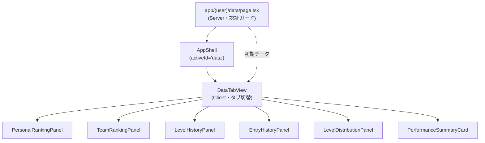
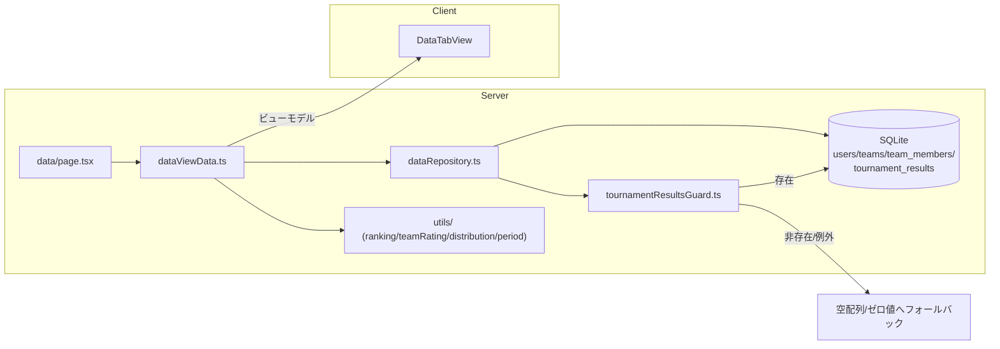

# Design Document

## Overview

「データ」タブ（`GRAN_Data_Tab`）は、ログインユーザー向けの統計・ランキング・履歴を1つの導線で提供する閲覧専用機能である。本機能は次の5領域に加え、成績サマリ指標を提供する。

1. 個人ランキング（全体 / 規定階級内）
2. チームランキング
3. レベル推移
4. 出場履歴
5. レベル分布
6. 成績サマリ指標

### 設計方針

- **既存アーキテクチャへの完全準拠**: features ベース構成（`src/features/{domain}/{components,server,types,utils}`）、SQL は `server/*Repository.ts` にのみ閉じ込める、入力は Zod 検証、Server Components / Server Actions 主体、日時は `NOW_JST`（JST文字列）という既存規約を踏襲する。
- **閲覧専用（Requirement 11）**: データタブは `users` / `teams` / `tournament_results` を一切変更しない。SQL は `SELECT` のみとし、更新系関数は定義しない。
- **既存ロジックの再利用**: 階級（tier）判定は `src/features/auth/utils/classLabel.ts` の `granLevelToTier` / `granLevelToClassLabel` を再利用し、新たな境界値を定義しない。
- **防御的データアクセス**: レベル推移・出場履歴・成績サマリが依存する `tournament_results` テーブルは現時点で未作成（定義のみ）。データアクセス層は同テーブルが存在する前提のクエリを用意しつつ、テーブル非存在／0件時はクラッシュせず空配列・ゼロ値へフォールバックする（Requirement 10）。
- **サーバ集計 + クライアント表示**: データ取得・集計は Server Component / リポジトリで行い、タブ切替・ソート・フィルタなどのインタラクションは Client Component が担う。グラフは外部ライブラリを導入せず軽量な自前実装（SVG / div バー）とする。
- **アクセシビリティ**: 順位・レベル・成績などの重要情報は HTML テキスト化し、グラフには表（またはテキスト）併記、タッチターゲットは 44px 以上、現在タブには `aria-current` を付与する。

### 既存アーキテクチャとの整合

| 既存要素 | 本機能での扱い |
|---|---|
| `navConfig.ts` の `data` 項目（`href: "#", implemented: false`） | `href: "/data", implemented: true` に変更する |
| `AppShell.tsx` | 既存のまま再利用。ページで `activeId="data"` を指定しラップする |
| `AppShell` のレスポンシブ境界 | Tailwind の `sm`（640px）。サイドバー（sm以上）/ ボトムナビ（sm未満） |
| `getCurrentUser()`（`currentUser.ts`） | 認証ガードと自身の行ハイライトに利用。`rankInClass` へ本機能のランキング算出を将来接続する |
| `granLevelToTier` / `granLevelToClassLabel` | tier 判定・ラベル表示に再利用 |
| `tournamentRepository.ts` / `userRepository.ts` / `teamRepository.ts` | Row→ビューモデル変換、`prepare/all/get`、集計サブクエリの作法を踏襲 |

### 設計上の決定事項（Decision / Assumption）

要件のオープンな論点に対する設計判断を以下に明記する。

- **Decision（論点F / ブレークポイント）**: データタブのレスポンシブ境界は既存 `AppShell` 実装に合わせ Tailwind `sm`（640px）に確定する。要件が暫定とした 768px は採用しない。sm 以上でサイドバー、sm 未満でボトムナビおよび画面内タブを表示する。
- **Decision（論点C / 未査定ユーザー）**: `is_level_calibrated = false` のユーザーは、順位の母集団（個人ランキング・階級内ランキング・レベル分布の順位・区間人数）から除外する。別枠で「査定中」ラベルを付けて区別表示できるようにし、`getCurrentUser()` が `classLabel="査定中"` を返す既存挙動と整合させる。
- **Decision（論点B / 同率時順序）**: 同率時は安定順序として `gran_level DESC` → `rated_match_count DESC` → `login_id ASC`（最終タイブレークに `created_at ASC` を併用）で決定する。勝率は `tournament_matches` 未実装のため当面タイブレークに用いない。
- **Decision（論点A / チーム指標）**: チームGRANレベル指標は「`team_members` のうち有効な `gran_level`（100〜999）を持つメンバーの平均レート（整数丸め。四捨五入 `ROUND`）」とする。種目・部門での区別は将来拡張とし、当面は全チーム一括で扱う。
- **Decision（論点D / 勝率）**: `tournament_matches` 未実装のため勝率は当面「未算出」とし、UI ではダッシュ（`—`）表示または非表示とする。勝率算出のための項目（勝利件数）はビューモデルにオプショナルで用意し、将来接続する。
- **Decision（論点E / 期間フィルタ）**: レベル推移・出場履歴の期間フィルタ初期選択肢は「全期間 / 直近1年 / 直近6ヶ月 / 直近3ヶ月」とする。
- **Assumption（グラフライブラリ）**: 外部グラフライブラリは導入しない（依存最小化・SSR 親和性・アクセシビリティ併記の容易さのため）。レベル推移は SVG 折れ線、レベル分布は div ベースの横棒／縦棒で自前描画する。将来的に要件が高度化した場合は再検討する。
- **Assumption（`tournament_results` スキーマ）**: 本機能が参照する列は `user_id` / `tournament_id` / `pre_gran_level` / `gran_level_diff` / `post_gran_level` / `rank_type` / `recorded_at`。同テーブルが正式実装される際はこの列構成に準拠することを前提とする。

## Architecture

### ディレクトリ構成

```
src/
  app/
    (user)/
      data/
        page.tsx                      # /data ルート（Server Component・認証ガード・初期データ取得）
  features/
    data/
      components/
        DataTabView.tsx               # 画面内タブの親（Client, "use client"）。5+1領域を切替
        PersonalRankingPanel.tsx      # 個人ランキング（全体/階級内タブ）Client
        TeamRankingPanel.tsx          # チームランキング Client
        LevelHistoryPanel.tsx         # レベル推移（期間フィルタ + SVGグラフ + 表）Client
        EntryHistoryPanel.tsx         # 出場履歴（ソート/フィルタ）Client
        LevelDistributionPanel.tsx    # レベル分布（全体/階級別・ヒストグラム）Client
        PerformanceSummaryCard.tsx    # 成績サマリ指標 Client/Server
        RankRow.tsx                   # ランキング1行（アバター/代替アイコン/ハイライト）
        EmptyState.tsx                # 空状態表示（共通）
        ErrorRetry.tsx                # 取得失敗時エラー + 再取得（Client）
      server/
        dataRepository.ts             # SQL を集約（SELECT のみ）。SQLは全てここ
        dataViewData.ts               # リポジトリ呼び出し + ビューモデル組み立て（Server）
        tournamentResultsGuard.ts     # tournament_results のテーブル存在チェック
      types/
        data.ts                       # ビューモデル型
      utils/
        ranking.ts                    # 同率順序・順位付与の純粋関数
        teamRating.ts                 # チーム平均レート算出（整数丸め）
        distribution.ts               # レベル分布の区間集計（純粋関数）
        period.ts                     # 期間フィルタ（全期間/1年/6ヶ月/3ヶ月）の境界算出
  components/
    layout/
      navConfig.ts                    # data 項目を implemented: true / href: "/data" に変更
```

### コンポーネント関係図



### データフロー図



### 認証ガード

- `data/page.tsx` は Server Component として `getCurrentUser()`（内部で `getSession()`）を呼び、`null`（未認証）の場合は `redirect("/login")` する（Requirement 1.6）。既存 `tournaments/page.tsx` の `viewer` 解決 → `redirect("/login")` パターンを踏襲する。
- 取得した `CurrentUser` を各パネルへ渡し、自身の行ハイライト（Requirement 2.4 / 3.4）と自身位置インジケータ（Requirement 7.4）に用いる。

## Components and Interfaces

### ページ / レイアウト

- `DataPage`（Server）: 認証ガード → `dataViewData` から初期データを取得 → `AppShell activeId="data"` でラップ → `DataTabView` に props として渡す。
- `DataTabView`（Client）: 画面内タブ（個人/チーム/推移/出場/分布/成績）を `aria-current` 付きで切替。各タブは 44px 以上のタッチターゲット。

### リポジトリ（`dataRepository.ts`・SQL は全てここ）

関数シグネチャ（戻り値はビューモデルまたは Row 由来の集計結果）:

```ts
// 個人ランキング（全体）: is_level_calibrated = 1 のみ、同率順序で整列。
listPersonalRanking(): RankedUser[];

// 階級内ランキング: tier に属する査定済ユーザーのみ。
listTierRanking(tier: TournamentTier): RankedUser[];

// チームランキング: team_members の有効 gran_level 平均（丸め前の集計素材）を返す。
listTeamRatingRows(): TeamRatingRow[];

// レベル分布: 査定済ユーザーの gran_level 一覧（区間集計は utils で実施）。
listCalibratedLevels(): number[];
// 未査定ユーザー数（別枠表示用）。
countUncalibratedUsers(): number;

// レベル推移: 自身の tournament_results を recorded_at 昇順で。未整備時は []。
getLevelHistory(userId: string): LevelHistoryPoint[];

// 出場履歴: 自身の出場一覧。ソート/フィルタはアプリ側（utils / Client）で実施。未整備時は []。
listEntryHistory(userId: string): EntryHistoryRow[];

// 成績サマリ: 自身の件数集計（総出場/優勝/準優勝）。未整備時は全て 0。
getPerformanceSummary(userId: string): PerformanceSummary;
```

補助:

```ts
// tournament_results テーブルが存在するか（sqlite_master を参照）。
tournamentResultsTableExists(): boolean;
```

SQL 作法は既存に準拠する（`db.prepare(...).all()` / `.get()`、snake_case 行 → camelCase ビューモデル変換、集計はサブクエリ）。例（概念）:

```sql
-- 個人ランキング（全体・査定済のみ・同率安定順序）
SELECT id, login_id, nickname, avatar_url, gran_level, rated_match_count, created_at
  FROM users
 WHERE is_level_calibrated = 1 AND gran_level BETWEEN 100 AND 999
 ORDER BY gran_level DESC, rated_match_count DESC, login_id ASC, created_at ASC;

-- チーム平均レート素材（有効 gran_level メンバーのみ）
SELECT t.id, t.name, t.avatar_url, u_lead.nickname AS leader_nickname,
       AVG(um.gran_level) AS avg_level, COUNT(um.user_id) AS member_count
  FROM teams t
  JOIN users u_lead ON u_lead.id = t.leader_user_id
  LEFT JOIN team_members tm ON tm.team_id = t.id
  LEFT JOIN users um ON um.id = tm.user_id
       AND um.gran_level BETWEEN 100 AND 999
 GROUP BY t.id;
```

### 防御的データアクセス（`tournamentResultsGuard.ts`）

- `tournamentResultsTableExists()` は `SELECT name FROM sqlite_master WHERE type='table' AND name='tournament_results' LIMIT 1` で存在確認する。
- `tournament_results` に依存する関数（`getLevelHistory` / `listEntryHistory` / `getPerformanceSummary`）は、呼び出し冒頭でテーブル存在チェックを行い、非存在なら即座に空配列 / ゼロ値を返す。クエリ実行で例外が発生した場合も `try/catch` で捕捉し、同様に空へフォールバックする（Requirement 10.1〜10.4）。クラッシュさせない。
- `users` / `teams` にのみ依存する機能（個人ランキング・レベル分布）は常に算出可能であり、フォールバック対象外（Requirement 10.4）。

### ユーティリティ（`utils/`・純粋関数）

```ts
// ranking.ts: 同率安定順序で整列し、順位（1始まり）を付与。同率は同順位。
function rankUsers(users: RankableUser[]): RankedUser[];

// teamRating.ts: 有効メンバーの平均レートを整数丸め。有効メンバー0なら null（=除外）。
function computeTeamRating(memberLevels: number[]): number | null;

// distribution.ts: tier 8区間ごとの件数を集計。合計は入力件数に一致。
function buildDistribution(levels: number[]): DistributionBin[];

// period.ts: 期間種別 → 下限 recorded_at（JST）を返す。全期間は null。
type PeriodFilter = "ALL" | "1Y" | "6M" | "3M";
function periodLowerBound(period: PeriodFilter, now: string): string | null;
```

### パネルコンポーネント

| コンポーネント | 責務 | 主な要件 |
|---|---|---|
| `PersonalRankingPanel` | 全体/階級内タブ切替、自身行ハイライト、代替アイコン、空状態 | 2, 3 |
| `TeamRankingPanel` | チーム順位、代表者ニックネーム、プレースホルダーアイコン、空状態 | 4 |
| `LevelHistoryPanel` | 期間フィルタ、SVG折れ線 + 表併記、空状態、エラー再取得 | 5 |
| `EntryHistoryPanel` | ソート（開催日/種目/成績）・フィルタ（種目/階級）、空状態、エラー再取得 | 6 |
| `LevelDistributionPanel` | 全体/階級別ヒストグラム、自身位置インジケータ、表併記、空状態 | 7 |
| `PerformanceSummaryCard` | 総出場/優勝/準優勝、勝率（当面 `—`）、ゼロ表示、エラー再取得 | 9 |
| `RankRow` | 1行表示（アバター or 代替アイコン、ハイライト、aria テキスト） | 2.4, 2.8, 8 |
| `EmptyState` / `ErrorRetry` | 空状態 / 取得失敗 + 再取得の共通UI | 10, 5.8, 6.9, 9.5 |

## Data Models

ビューモデル型（`types/data.ts`）。DB 行は snake_case、ビューモデルは camelCase に変換する。

```ts
import type { TournamentTier, TournamentCategory } from "@/features/tournaments/types/tournament";

// ランキング整列に必要な素材。
export interface RankableUser {
  id: string;
  loginId: string;
  nickname: string;
  avatarUrl: string | null;
  granLevel: number;       // 100〜999
  ratedMatchCount: number;
  createdAt: string;
}

// 順位付与後の表示モデル。
export interface RankedUser extends RankableUser {
  rank: number;            // 1始まり。同率は同順位
  tier: TournamentTier;    // granLevelToTier 準拠
  classLabel: string;      // granLevelToClassLabel 準拠
}

// チーム順位の集計素材（リポジトリ戻り値）。
export interface TeamRatingRow {
  id: string;
  name: string;
  avatarUrl: string | null;
  leaderNickname: string;
  memberLevels: number[];  // 有効 gran_level のみ
}

// チーム順位の表示モデル。
export interface RankedTeam {
  id: string;
  name: string;
  avatarUrl: string | null;
  leaderNickname: string;
  teamRating: number;      // 平均レート（整数丸め）
  rank: number;            // 同率は同順位。同率はリーダーニックネーム昇順
}

// レベル分布の1区間。
export interface DistributionBin {
  tier: TournamentTier;
  lower: number;           // 区間下限（例: A=850）
  upper: number;           // 区間上限（例: A=999）
  count: number;           // 区間内人数
}

// レベル推移の1点。
export interface LevelHistoryPoint {
  tournamentTitle: string | null;
  preGranLevel: number;
  granLevelDiff: number;
  postGranLevel: number;
  recordedAt: string;      // JST
}

// 出場履歴の1行。
export interface EntryHistoryRow {
  tournamentTitle: string;
  eventDate: string;       // YYYY-MM-DD
  category: TournamentCategory;
  tier: TournamentTier;
  rankType: ResultRank;
  granLevelDiff: number | null; // 未記録は null → UI でプレースホルダー
}

// 成績サマリ指標。
export interface PerformanceSummary {
  totalEntries: number;
  winCount: number;        // rank_type = 'T1_WINNER'
  runnerUpCount: number;   // rank_type = 'T1_RUNNER_UP'
  winRate: number | null;  // 論点D: 当面 null（未算出）
}

// 成績区分（result_rank_enum）。
export type ResultRank =
  | "PARTICIPATED"
  | "L2_WINNER"
  | "T1_RUNNER_UP"
  | "T1_WINNER";

// 自身サマリ（個人/階級内ランキングのヘッダ表示）。
export interface SelfRankSummary {
  granLevel: number;
  isCalibrated: boolean;
  totalCount: number;           // 母集団人数
  overallRank: number | null;   // 対象外（査定中）は null
  tier: TournamentTier;
  classLabel: string;           // 査定中は "査定中"
}
```

公開プロフィールの非公開項目（本名・フリガナ・電話番号・メール・生年月日・個人エントリー者本名）は、ビューモデルに**含めない**ことで非表示を構造的に保証する（Requirement 2.3 / 8.2 / 8.4）。

## Correctness Properties

*A property is a characteristic or behavior that should hold true across all valid executions of a system—essentially, a formal statement about what the system should do. Properties serve as the bridge between human-readable specifications and machine-verifiable correctness guarantees.*

本機能のランキング整列・tier判定・分布集計・チーム平均・成績集計は純粋関数として切り出せるため、property-based testing を適用する。以下の性質は `src/features/data/utils/` の純粋関数と `dataRepository` の集計結果に対して検証する。

### Property 1: ランキングの安定順序（単調性 + タイブレーク）

*For any* 査定済ユーザーの集合に対し、`rankUsers` の出力は `gran_level` の降順（単調非増加）で並び、`gran_level` が同一の要素間では `rated_match_count` の降順、さらに同一なら `login_id` の昇順で安定的に並ぶ。

**Validates: Requirements 2.1, 2.9, 3.2, 3.6**

### Property 2: 未査定ユーザーの母集団除外

*For any* 査定済・未査定が混在するユーザー集合に対し、個人ランキング・階級内ランキング・レベル分布の母集団（順位付与対象および各区間の件数）には `is_level_calibrated = false` のユーザーが一切含まれない。

**Validates: Requirements 2.10, 3.7, 7.8**

### Property 3: 階級フィルタ結果の健全性

*For any* ユーザー集合と任意の規定階級 `tier` に対し、`listTierRanking(tier)` の全要素は `granLevelToTier(granLevel) === tier` を満たし、かつ `gran_level` の降順で並ぶ。

**Validates: Requirements 3.2, 3.3**

### Property 4: tier 判定が granLevelToTier と一致

*For any* 100〜999 の `gran_level` に対し、本機能が算出する規定階級は `granLevelToTier(granLevel)` と常に一致する。

**Validates: Requirements 3.3, 7.2**

### Property 5: チーム平均レートの丸め整合

*For any* 有効 `gran_level`（100〜999）を1件以上持つメンバーレベル配列に対し、`computeTeamRating` の戻り値は当該レベルの算術平均を四捨五入した整数に等しい。

**Validates: Requirements 4.4**

### Property 6: チームランキングの順序と有効メンバー要件

*For any* チーム集合に対し、チームランキングの出力は `teamRating` の降順で並び、同一 `teamRating` のチームは同一順位かつ代表者ニックネームの昇順で並び、有効 `gran_level` メンバーが0名のチームは出力に含まれない。

**Validates: Requirements 4.1, 4.5, 4.6, 4.7**

### Property 7: レベル推移の昇順と期間フィルタの健全性

*For any* 履歴集合と任意の期間種別に対し、`getLevelHistory` の出力は `recorded_at` の昇順（単調非減少）で並び、期間フィルタ適用後の全変動点は `periodLowerBound(period)` 以降（全期間なら全件）に限定される。

**Validates: Requirements 5.3, 5.4, 5.5**

### Property 8: レベル分布の区間正当性と件数保存

*For any* 査定済ユーザーのレベル集合に対し、`buildDistribution` の各区間は8段階の規定階級境界に一致し、各区間の `count` はその区間範囲に属するレベルの件数に等しく、全区間の `count` の合計は入力レベル件数に等しい。

**Validates: Requirements 7.1, 7.2**

### Property 9: 出場履歴のソート安定性とフィルタ健全性

*For any* 出場履歴集合と任意のソートキー・方向・フィルタ条件に対し、出力は指定キー・方向で整列され、ソートキーが等しい行は開催日の降順で安定的に並び、フィルタ適用後の全行は指定条件（種目区分・階級）に一致する。

**Validates: Requirements 6.4, 6.5, 6.6**

### Property 10: 非公開プロフィール項目の非露出

*For any* ユーザーまたはチームのビューモデルに対し、本名・フリガナ・電話番号・メールアドレス・生年月日・個人エントリー者本名のいずれの項目も含まれない。

**Validates: Requirements 2.2, 2.3, 8.2, 8.4**

### Property 11: 成績サマリの母集団分離

*For any* 複数ユーザーの `tournament_results` が混在する集合と任意の閲覧ユーザー `userId` に対し、`getPerformanceSummary(userId).totalEntries` は当該 `userId` に紐づくレコード件数に等しく、他ユーザーのレコードを一切含まない。

**Validates: Requirements 9.1, 9.2**

### Property 12: 成績サマリの件数集計整合

*For any* 閲覧ユーザーの `tournament_results` 集合に対し、`winCount` は `rank_type = 'T1_WINNER'` のレコード件数に等しく、`runnerUpCount` は `rank_type = 'T1_RUNNER_UP'` のレコード件数に等しい。

**Validates: Requirements 9.1**

### Property 13: 履歴データ未整備時に例外を投げない

*For any* `tournament_results` が非存在、または取得時に例外が発生する条件に対し、`getLevelHistory` / `listEntryHistory` は例外を投げず空配列を返し、`getPerformanceSummary` は例外を投げず全指標を0（`winRate` は `null`）とした結果を返す。

**Validates: Requirements 10.1, 10.2, 10.4**

### Property 14: 閲覧専用（副作用非発生）

*For any* データタブの取得系関数の呼び出しに対し、呼び出し前後で `users` / `teams` / `team_members` / `tournament_results` の各テーブルのレコード件数および内容は変化しない。

**Validates: Requirements 11.1, 11.2**

## Error Handling

エラーと空状態を明確に区別して扱う（Requirement 10 の要となる方針）。

| 状況 | 扱い | 対象要件 |
|---|---|---|
| 未認証アクセス | `redirect("/login")`（ページガード） | 1.6 |
| `tournament_results` テーブル非存在 | 例外を投げず空配列/ゼロ値へフォールバック → 空状態表示 | 10.1, 10.2 |
| `tournament_results` クエリ中の例外 | `try/catch` で捕捉し空へフォールバック（エラー画面にしない） | 10.2 |
| 取得0件（ランキング/分布/推移/履歴） | `EmptyState` を表示（データ未記録の説明テキスト付き） | 2.7, 3.5, 4.8, 4.9, 5.6, 6.8, 7.7, 10.3 |
| 期間/フィルタ適用後に0件 | 条件に一致なしの説明テキスト（空状態） | 5.7, 6.7 |
| レベル推移/出場履歴/成績サマリの**取得失敗**（例外が上位へ伝播したケース） | `ErrorRetry`（エラー表示 + 再取得ボタン） | 5.8, 6.9, 9.5 |
| アイコン未設定/取得不能 | 代替アイコンを表示し他項目は継続表示 | 2.8, 4.3 |
| `gran_level_diff` 未記録 | プレースホルダー表示（他項目は継続） | 6.3 |

- **空状態 vs エラーの判断基準**: データソースが「整備されているが0件」および「`tournament_results` 未整備」は空状態。明示的な取得失敗（接続不能・想定外例外が再取得で解消しうる状態）はエラー + 再取得とする。未整備フォールバックが空状態を保証するため、通常運用でエラー画面には至らない。
- **再取得**: `ErrorRetry` はクライアント側で再フェッチ（Server Action またはルート再検証）をトリガーする。

## Testing Strategy

### デュアルテスト方針

- **ユニットテスト（例ベース）**: UI構成・リダイレクト・エラー/空状態分岐・自身行ハイライト・勝率ダッシュ表示など、入力で挙動が変わらない具体シナリオと境界（0件）を検証する。
- **プロパティテスト**: 上記 Correctness Properties を純粋関数（`utils/`）および集計結果に対して検証する。ランキング整列・tier判定・分布集計・チーム平均・成績集計・フォールバックが対象。

PBT が適切な理由: これらは `gran_level` の配列やレコード集合を入力とする純粋な変換・集計であり、「任意の入力集合に対して成り立つ普遍性質」（単調性・保存則・母集団分離・丸め整合・例外非発生）を自然に表現できる。一方、レイアウト/タッチターゲット/読み上げテキストの体感やリダイレクトは例ベースで扱う。

### プロパティテスト構成

- **ライブラリ**: TypeScript 向けの property-based testing ライブラリとして `fast-check` を採用する（自前実装はしない）。テストランナーは Next.js プロジェクトに標準的な `vitest` を単発実行（`vitest --run`）で用いる想定。いずれも新規 devDependency として追加する。
- **反復回数**: 各プロパティテストは最低 100 回の反復（`fc.assert(..., { numRuns: 100 })`）で実行する。
- **タグ**: 各プロパティテストに設計プロパティを参照するコメントを付与する。
  - タグ形式: `// Feature: data-tab, Property {number}: {property_text}`
- **1プロパティ = 1プロパティテスト**: 各 Correctness Property は単一のプロパティテストで実装する。
- **ジェネレータ**: `gran_level` は 100〜999、`is_level_calibrated` は boolean、`rated_match_count` は 0以上、`rank_type` は enum、`recorded_at` は JST 文字列として生成する。空集合・同率・全未査定・アイコン null・混在 user などのエッジはジェネレータで自然に網羅する（Property 2/8 のエッジ含む）。
- **フォールバック（Property 13）**: `tournament_results` 非存在/例外を注入するため、テスト用に空の SQLite（当該テーブル未作成）および例外を投げるスタブ db を用いる。
- **副作用非発生（Property 14）**: テスト用 SQLite にシード後、取得系関数呼び出しの前後で各テーブルの `COUNT(*)` と内容ハッシュが不変であることを検証する。

### ユニットテスト（例ベース）対象の抜粋

- 認証ガード: セッションなしで `/login` へ redirect（1.6）。
- 自身行の識別テキスト付与（2.4 / 3.4）、自身が母集団外（査定中）での「対象外」表示（2.6）。
- 空状態 / エラー + 再取得 UI の表示分岐（5.6–5.8 / 6.7–6.9 / 7.7 / 9.4–9.5）。
- 勝率が `null` のときダッシュ表示（9.3）。
- `navConfig` の `data` 項目が `implemented: true` / `href: "/data"`。

## Requirements Traceability

| Requirement | 対応設計要素 |
|---|---|
| 1. アクセスと画面構成 | `data/page.tsx`（認証ガード・3秒目安のサーバ取得）、`DataTabView`（画面内タブ）、`AppShell`（sm境界: サイドバー/ボトムナビ・Decision 論点F）、44px・`aria-current`・HTMLテキスト方針、`navConfig` 変更 |
| 2. 個人ランキング（全体） | `listPersonalRanking`、`rankUsers`（Property 1）、`RankRow`（代替アイコン/ハイライト）、`SelfRankSummary`、未査定除外（Property 2・Decision 論点C）、非公開項目非露出（Property 10） |
| 3. 個人ランキング（階級内） | `listTierRanking(tier)`、`granLevelToTier` 再利用（Property 3/4）、同率順序（Property 1・Decision 論点B）、空状態 |
| 4. チームランキング | `listTeamRatingRows` + `computeTeamRating`（Property 5/6・Decision 論点A）、プレースホルダーアイコン、空状態、種目区別は将来拡張 |
| 5. レベル推移 | `getLevelHistory(userId)`、`period.ts`（Decision 論点E）、SVG + 表併記、空状態/エラー再取得（Property 7） |
| 6. 出場履歴 | `listEntryHistory`、ソート/フィルタ utils（Property 9）、未記録プレースホルダー、空状態/エラー再取得 |
| 7. レベル分布 | `listCalibratedLevels` + `buildDistribution`（Property 4/8）、自身位置インジケータ、`countUncalibratedUsers`（Decision 論点C）、表併記、空状態 |
| 8. 公開プロフィール内データ閲覧 | ビューモデルに公開項目のみ格納（Property 10） |
| 9. 成績サマリ指標 | `getPerformanceSummary(userId)`（Property 11/12）、勝率 `null`=ダッシュ（Decision 論点D）、0表示、エラー再取得 |
| 10. 未整備時フォールバック | `tournamentResultsGuard.ts`（存在チェック + try/catch、Property 13）、空状態、users/teams 由来は常時算出（10.4） |
| 11. 閲覧専用動作 | SQL は SELECT のみ・更新系関数なし（Property 14） |

## Future Integration Points

- **`currentUser.ts` の `rankInClass`**: 現在「順位機能未実装のため暫定0」。本機能の `listTierRanking(tier)` で算出した自身の階級内順位をここへ接続できるよう、`rankUsers` を共有可能な純粋関数として `utils/ranking.ts` に配置する。
- **`tournament_matches`（勝率）**: 実装後、`PerformanceSummary.winRate` を実値に差し替える（Decision 論点D）。ビューモデルに `winCount` 枠を用意済み。
- **チーム指標の種目別化**: 将来、種目・部門（`tournament_category_enum`）単位のチームランキングへ拡張する（Decision 論点A）。
- **`tournament_results` 正式実装**: Assumption の列構成に準拠してテーブルが作成され次第、`tournamentResultsGuard` のフォールバック経路から実データ経路へ自動的に移行する（コード変更不要）。
