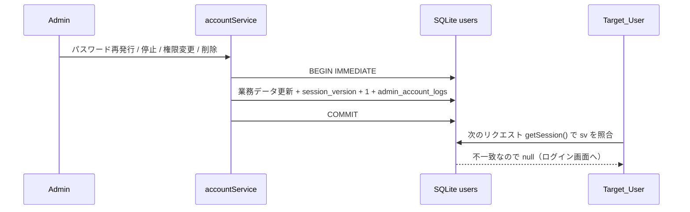
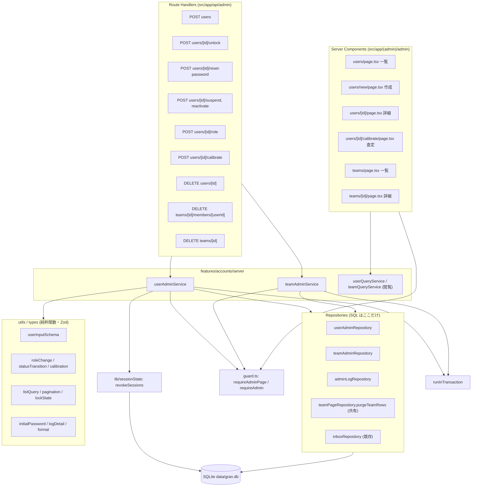
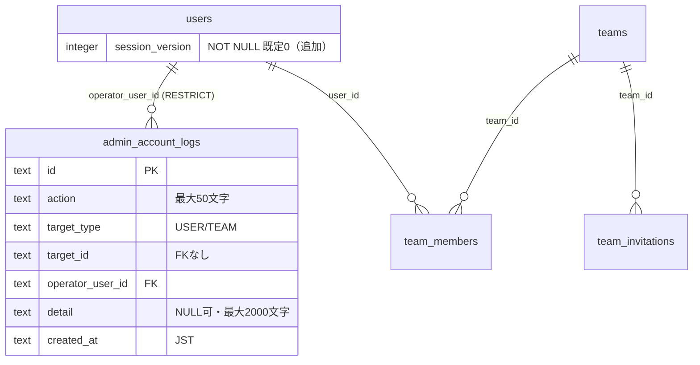

# Design Document

## Overview

管理コンソール（`/admin`）に「ユーザ・チーム管理」を追加する。ユーザーの一覧・詳細・作成・ロック解除・パスワード再発行・停止/再開・権限変更・初期レベル査定・削除、チームの一覧・詳細・メンバー除名・解散、およびそれらの監査ログ（`admin_account_logs`）が対象である（requirements.md の Requirement 1〜15）。

### 既存コードの調査結果

| 領域 | 現状（参照元） | 本設計への影響 |
| --- | --- | --- |
| 認可 | `permissions.ts` に `accounts.manage` / `roles.manage` が定義済みで ADMIN のみ。`guard.ts` の `requireAdminPage` / `requireAdmin` / `withAdminApi` は毎回 DB の最新 role / status を参照する | 新しい権限は追加しない。既存のガードを使う |
| ナビ | `navConfig.ts` の `users-teams`（`/admin/users`、`accounts.manage`）が `implemented: false` | `true` に変更するだけでよい |
| **セッション** | **Refresh Token は存在しない。** `session.ts` は単一の署名付き JWT（有効期限 7 日）を Cookie に入れるだけで、`getSession()` は署名と期限しか検証しない。DB への失効管理は無い（`session.ts` の冒頭コメントにも「将来拡張」とある） | 要件の `Session_Revoker`（6.3、7.2、8.2、10.7）を満たす仕組みを新設する。後述の「セッション失効」 |
| ログイン | `loginAction` は `SUSPENDED` を拒否し、`isLocked`（`locked_until` が未来）でロック拒否する。失敗 10 回で `locked_until = '9999-12-31 23:59:59'` を設定 | ロック解除は `failed_login_attempts = 0`、`locked_until = NULL` で既存ログインが通る（5.8） |
| 停止ユーザーの一般画面 | `getSession()` が DB を見ないため、停止済みでも JWT が有効な間は一般画面が使える | セッション失効の方式で同時に解消する |
| ユーザー作成 | `userRepository.createUser` は role を `USER` に固定し、`login_id` 採番 `nextLoginId` は非公開。上限 999999 の検査も無い | 管理者用の作成関数と採番を新設する。既存関数は変更しない |
| 初期レベル | `level.ts` の `estimateInitialGranLevel` は `Math.round`。`A` は (850+999)/2 = 924.5 で 925 になる | 要件 4.5 は切り捨て（924）。管理者用に `floor` の別関数を作る。既存関数は変更しない |
| チーム解散 | `teamPageRepository.deleteTeamAsLeader` が、`entries`・`waitlists`・`tournament_results` の削除と、`tournament_matches` / `notification_logs` の参照の NULL 化を、`BEGIN IMMEDIATE` つきで実行する | 削除ロジックを `purgeTeamRows`（トランザクション制御なし）に切り出し、既存関数と管理者用の解散の両方から使う（要件 13.10 と一致） |
| 除名 | `teamPageRepository.removeMember` は代表者向けで、招待の更新・通知は行わない | 管理者用の除名を別に作る |
| FK | `entries.user_id`、`entry_members.user_id`、`waitlists.user_id`、`tournament_results.user_id`、`notification_logs.user_id`、`entry_payment_logs.changed_by` は `ON DELETE` 指定なし（NO ACTION）。`teams.leader_user_id` / `team_members` / `team_invitations` / `inbox_notifications` / `user_settings` は `CASCADE` | 過去のエントリー等が残るユーザーを `DELETE` すると FK 違反になる。事前に検出して専用エラーを返す（要確認事項 1） |
| 通知 | `inbox_notifications.kind` の CHECK は 5 値のみ。`notification_logs.delivery_type` の CHECK にチーム系の種別は無い | 除名・解散の通知は `kind = 'ANNOUNCEMENT'` で `inbox_notifications` に登録する。CHECK の変更（テーブル再作成）は避ける |
| スキーマ変更 | `applySchema` に `CREATE TABLE IF NOT EXISTS` と `ensureColumn`。`applySchema` は `export` 済み | 同じ流儀で追加する |
| 書き込み API | 大会管理は Route Handler。トランザクションは `db.exec("BEGIN")` の手書き | Route Handler を使い、トランザクションの手書きを `runInTransaction` に集約する |
| middleware | `middleware.ts` / `proxy.ts` は存在しない | 各ページと各サービスで認可する既存方針を踏襲する |
| テスト | vitest 3.2.4 + fast-check 4.10.2、`GRAN_DB_PATH=:memory:`、`__tests__` を実装の隣に置く | 同じ構成にする |

### 設計判断

1. **配置**: `src/features/accounts/` を新設する（`types` / `utils` / `server` / `components`）。`features/admin` にはガードとナビだけを置く現状を保つ。
2. **サービス層で認可する**: すべてのサービス関数が冒頭で `requireAdmin("accounts.manage")` を呼び、失敗時は例外ではなく Unified_Error を返す（1.6〜1.8）。Route Handler は結果を HTTP に変換するだけで、`withAdminApi` は重ねない。権限判定の場所を 1 か所にして、ページ以外から直接呼ばれても保護されるようにする。権限変更は追加で `roles.manage` を検証する（1.9、1.10）。
3. **トランザクションは同期関数に閉じる**: `node:sqlite` は同期 API のため、認可（非同期）→ `BEGIN IMMEDIATE` → 検証・更新・ログ・通知（同期）→ `COMMIT` の順にする。トランザクション内で呼び出しユーザーの権限を再評価し、認可からコミットまでの間の権限変更（最後の管理者の判定を含む）に備える。
4. **セッション失効は `users.session_version` で行う**（次節）。
5. **ログと業務データを同一トランザクションにする**（14.4、14.5）。通知（除名・解散）も同一トランザクションに入れ、失敗時に通知だけが残らないようにする（12.7、13.9）。
6. **一覧・詳細はサーバーコンポーネントで取得**し、フィルタは URL の `searchParams` で持つ。書き込みは確認ダイアログから Route Handler を呼ぶ。
7. **平文の Initial_Password は応答 1 回のみ**。DB・ログ・URL・サーバーログには残さず、応答に `Cache-Control: no-store` を付ける（4.4、6.4、14.6）。

## セッション失効

### 検討した方式

| 案 | 内容 | 評価 |
| --- | --- | --- |
| A（採用） | `users.session_version`（整数、既定 0）を追加。JWT に `sv` を入れ、`getSession()` が DB の値と照合する | テーブル追加なし。ユーザー単位で一括失効できる。`getSession` に PK 検索が 1 回増えるが、`node:sqlite` は同期でローカルなので影響は小さい |
| B | 発行済みトークンの `jti` を保持する `sessions` テーブルを新設（Refresh Token 相当） | 端末別の失効ができるが、ログイン・ログアウト・登録の全経路の変更が必要で、要件の範囲を超える |
| C | `getSession()` で `status` だけ確認 | 停止は防げるが、パスワード再発行と権限変更で既存セッションを失効できない |

### 仕様

- `applySchema` に `ensureColumn("users", "session_version", "INTEGER NOT NULL DEFAULT 0")` を追加する。既存行は 0。
- `SessionPayload` に任意の `sv?: number` を追加する。`verifySessionToken` は `sv` クレームを読み、無ければ 0 とする。**`sv` を持たない既存の JWT は、DB の値が 0 の間は有効のまま**で、ログイン中の全ユーザーが一斉に切断されることはない。
- `setSessionCookie(payload)` は、`payload.sub` の `session_version` を DB から読んで JWT に `sv` として入れる。呼び出し元（`registerAction`、`loginAction`）は変更しない。
- `getSession()` は JWT 検証後に `evaluateSessionValidity(row, payload.sv ?? 0)` を呼び、次のいずれかなら `null` を返す。
  - `users` に行が無い（削除済み）
  - `status = 'SUSPENDED'`
  - `row.session_version !== sv`
- `PROVISIONAL` は既存のログイン処理が拒否していないため、ここでも拒否しない。
- `revokeSessions(userId)` は `UPDATE users SET session_version = session_version + 1 WHERE id = ?` を実行する。業務データの更新と同じトランザクション内で呼ぶので、更新が失敗すれば失効も取り消される（7.9、8.9）。
- 失効の反映は DB 更新のコミット直後で、5 秒以内の要件（7.2、8.2）を満たす。ブラウザの Cookie は残るが、次のリクエストで `getSession()` が `null` を返し、既存の「未ログイン」処理に流れる。
- `evaluateSessionValidity` は DB に触れない純粋関数として `src/lib/sessionValidity.ts` に置き、テストしやすくする。DB の読み取りは `src/lib/sessionState.ts`（`db` を直接使う小さなモジュール）に置く。



## Architecture



### 権限

| 操作 | 必要権限 | 備考 |
| --- | --- | --- |
| 一覧・詳細の閲覧、作成、ロック解除、再発行、停止/再開、査定、削除、除名、解散 | `accounts.manage` | ADMIN のみ |
| User_Role の変更 | `accounts.manage` + `roles.manage` | 両方とも ADMIN のみ。サービスが `roleHasPermission(admin.role, "roles.manage")` を追加で検証する |

- ページ: `requireAdminPage("accounts.manage")`。未ログインは `/login`、権限不足（OPERATOR、`USER`、`LEADER`、停止中を含む）は `notFound()`（1.4、1.5）。ガードは DB の最新 role / status を参照するので、JWT の古い role は信用されない。
- サービス関数: 冒頭で `requireAdmin("accounts.manage")`。`AdminAccessError` を捕まえて `UNAUTHENTICATED`（認証必要）または `FORBIDDEN`（権限不足）の Unified_Error に変換し、DB には触れない（1.7、1.8）。
- `navConfig.ts`: `users-teams` を `implemented: true` にする（1.2）。`permission` は `accounts.manage` のままなので、OPERATOR には表示されない（1.3）。チーム一覧へは、ユーザー一覧ページ上部のタブ（「ユーザー」「チーム」）から移動する。

### URL 構成

| URL | 内容 |
| --- | --- |
| `/admin/users` | ユーザー一覧（Requirement 2、9.1） |
| `/admin/users/new` | アカウント作成（Requirement 4） |
| `/admin/users/{id}` | ユーザー詳細と各操作（Requirement 3、5〜8、10） |
| `/admin/users/{id}/calibrate` | 初期レベル査定（Requirement 9） |
| `/admin/teams` | チーム一覧（Requirement 11） |
| `/admin/teams/{id}` | チーム詳細、除名、解散（Requirement 11〜13） |

`{id}` が存在しない場合は `notFound()`（3.6、11.10）。詳細取得中の DB エラーは、部分表示をせずエラー表示にする（3.7）。

## Components and Interfaces

### ファイル構成（追加・変更）

```
src/lib/db.ts                         変更: users.session_version、admin_account_logs とインデックス
src/lib/session.ts                    変更: sv クレーム、getSession の有効性検証
src/lib/sessionState.ts               新規: findSessionState / revokeSessions
src/lib/sessionValidity.ts            新規: evaluateSessionValidity（純粋）
src/lib/transaction.ts                新規: runInTransaction
src/types/user.ts                     変更: SessionPayload に sv?: number
src/features/admin/utils/navConfig.ts 変更: users-teams を implemented: true
src/features/teams/server/teamPageRepository.ts  変更: purgeTeamRows を切り出す（挙動は不変）

src/features/accounts/
  types/account.ts            UserListRow、UserDetail、TeamListRow、TeamDetail、AdminLogRow、ServiceResult
  types/userSchema.ts         作成入力の Zod スキーマ
  utils/lockState.ts          isAccountLocked（純粋）、LOCKED_SQL
  utils/listQuery.ts          searchParams の正規化と検証、ページ範囲の算出
  utils/statusTransition.ts   停止・再開の遷移判定
  utils/roleChange.ts         planRoleChange
  utils/calibration.ts        CALIBRATION_RANGE、calibrationMidpoint、isOutOfRange
  utils/initialPassword.ts    generateInitialPassword
  utils/logDetail.ts          ログ detail の組み立て（秘密情報の混入防止、2,000 文字上限）
  utils/format.ts             未設定表示、表示範囲の文言
  server/userQueryService.ts  一覧・詳細（権限検証つき）
  server/teamQueryService.ts  チーム一覧・詳細（権限検証つき）
  server/userAdminRepository.ts   users の SELECT / INSERT / UPDATE / DELETE
  server/teamAdminRepository.ts   チームの SELECT / 除名 / 解散
  server/adminLogRepository.ts    admin_account_logs の INSERT / SELECT
  server/userAdminService.ts      作成・解除・再発行・停止/再開・権限・査定・削除
  server/teamAdminService.ts      除名・解散
  server/httpResult.ts            ServiceResult → Response（HTTP ステータス変換）
  components/                     UserTable、UserFilters、UserDetailView、CreateUserForm、CalibrateForm、TeamTable、TeamDetailView、
                                  OperationDialog（確認ダイアログの共通実装）、InitialPasswordNotice

src/app/(admin)/admin/users/…, teams/…        ページ
src/app/api/admin/users/…, teams/…             Route Handler
```

### Unified_Error と結果型

```ts
export type ErrorCode =
  | "UNAUTHENTICATED"   // 認証が必要            → 401
  | "FORBIDDEN"         // 権限不足              → 403
  | "NOT_FOUND"         // 対象なし              → 404
  | "VALIDATION"        // 入力不正              → 400
  | "CONFLICT"          // 競合・前提条件違反    → 409
  | "INTERNAL";         // サーバー内部エラー    → 500

export type ServiceResult<T = undefined> =
  | { ok: true; data: T }
  | { ok: false; code: ErrorCode; reason?: string; message: string; fieldErrors?: Record<string, string> };
```

- `reason` は `CONFLICT` の内訳を表す機械可読な識別子（`SELF_TARGET`、`LAST_ADMIN`、`NOT_LOCKED`、`INVALID_STATE`、`TEAM_LEADER`、`ACTIVE_ENTRY`、`HAS_HISTORY`、`LOG_OPERATOR`、`ROLE_UNCHANGED`、`LEADER_ROLE_REQUIRED`、`LEADER_NEEDS_TEAM`、`ACTIVE_TEAM_ENTRY`、`ASSIGNED_TO_ENTRY`、`NOT_MEMBER`、`IS_LEADER` など）。UI の文言はサーバーが `message` に入れて返す。
- `message` は固定の日本語文言。SQL・スタックトレース・内部 ID は含めない。`INTERNAL` は `console.error` に例外を出すが、応答には出さない。
- 確認テキスト（削除の `login_id`、解散のチーム名）の不一致は `VALIDATION`（`fieldErrors.confirm`）。ダイアログは開いたままにする（10.2、13.2）。

### `runInTransaction`（`src/lib/transaction.ts`）

```ts
// fn は同期関数。{ ok: false } を返す、または例外を投げると ROLLBACK する。入れ子は不可。
export function runInTransaction<R extends { ok: boolean }>(fn: () => R): R {
  db.exec("BEGIN IMMEDIATE");
  try {
    const result = fn();
    db.exec(result.ok ? "COMMIT" : "ROLLBACK");
    return result;
  } catch (e) {
    db.exec("ROLLBACK");
    throw e; // サービス層が INTERNAL に変換する
  }
}
```

`purgeTeamRows` のようにトランザクション制御を持たない関数だけを内部から呼ぶ。`deleteTeamAsLeader` は `BEGIN IMMEDIATE` を持ったまま `purgeTeamRows` を呼ぶ形に変更し、外部の挙動は変えない。

### 純粋関数

**`lockState.ts`**

```ts
export const LOCKED_SQL =
  "(u.failed_login_attempts >= 10 OR (u.locked_until IS NOT NULL AND u.locked_until > datetime('now','+9 hours')))";
export function isAccountLocked(u: { failedLoginAttempts: number; lockedUntil: string | null }, nowJst: string): boolean;
```

`nowJst` は `YYYY-MM-DD HH:mm:ss`。文字列比較で足りる（JST 固定形式）。画面の「ロック中」表示、「ロック解除」ボタンの出し分け、`unlock` の前提確認（`NOT_LOCKED`）はこの 1 つの定義を使う（5.1、5.2、5.6）。`loginAction` の `isLocked` は `locked_until` だけを見るが、`failed_login_attempts` が 10 以上で `locked_until` が NULL の行は、本設計ではロック中として表示し、解除で両方をリセットする。

**`statusTransition.ts`**

```ts
export type StatusAction = "SUSPEND" | "REACTIVATE";
export function planStatusChange(current: AccountStatus, action: StatusAction): { ok: true; to: AccountStatus } | { ok: false };
// SUSPEND は ACTIVE のときだけ → SUSPENDED、REACTIVATE は SUSPENDED のときだけ → ACTIVE。PROVISIONAL は両方とも不可。
```

**`roleChange.ts`**

```ts
export type RolePlan =
  | { kind: "APPLY"; isAdmin: boolean }
  | { kind: "INVALID_VALUE" } | { kind: "SELF_TARGET" } | { kind: "UNCHANGED" }
  | { kind: "LEADER_NEEDS_TEAM" } | { kind: "LEADER_ROLE_REQUIRED" };

export function planRoleChange(input: {
  actorId: string; targetId: string; current: UserRole; requested: unknown; isTeamLeader: boolean;
}): RolePlan;
```

判定順は次のとおり。

1. `targetId === actorId` なら `SELF_TARGET`（8.4）。
2. `requested` が 4 値以外なら `INVALID_VALUE`（8.5）。
3. `requested === current` なら `UNCHANGED`（8.7）。
4. `requested === "LEADER"` かつ `!isTeamLeader` なら `LEADER_NEEDS_TEAM`（8.6）。
5. `requested === "USER"` かつ `isTeamLeader` なら `LEADER_ROLE_REQUIRED`（8.8）。
6. それ以外は `APPLY`。`isAdmin = (requested === "ADMIN")`（8.1）。

`OPERATOR` への変更で `isTeamLeader` の場合は 4 と 5 のどちらにも当たらず許可される（8.8 の「`LEADER` または管理系の権限を保持」に一致）。

**`calibration.ts`**

```ts
export const CALIBRATION_RANGE: Record<DeclaredClass, readonly [number, number]> = {
  A: [850, 999], AB: [750, 870], B: [650, 770], BC: [550, 670],
  C: [450, 570], CD: [350, 470], D: [250, 370], DE: [100, 270],
};
export function calibrationMidpoint(c: DeclaredClass): number;           // Math.floor((min + max) / 2)
export function isOutOfRange(c: DeclaredClass, level: number): boolean;  // level < min || level > max
export function parseGranLevel(input: unknown): number | null;           // 100〜999 の整数のみ。空欄・小数・非数値は null
```

`CALIBRATION_RANGE` は `level.ts` の `CLASS_RANGE`（非公開）と同じ値で、`Math.round` と `floor` の違いがあるため別に持つ。`level.ts` は変更しない。

**`initialPassword.ts`**

```ts
// 紛らわしい文字（0/O、1/l/I）を除いた英数字から node:crypto の randomInt で 14 文字生成する。
// 英字と数字をそれぞれ 1 文字以上含める。
export function generateInitialPassword(): string;
```

12 文字以上（14 文字）、英数字のみ。暗号論的乱数を使うので、実行ごとに他の実行と異なる（6.8）。

**`logDetail.ts`**

```ts
export const MAX_DETAIL_LENGTH = 2000;
export function buildLogDetail(fields: Record<string, string | number | boolean | null>): string;
```

- キーの許可リストを持ち、`password`、`hash`、`token` を含むキー名は例外にする。呼び出し側は固定の形（下表）だけを渡す。
- JSON 化した長さが 2,000 を超えたら例外を投げる（DB の CHECK と二重の防御。例外はロールバックされ `INTERNAL`）。

**`listQuery.ts`**

```ts
export const PAGE_SIZE = 50;
export interface UserListQuery { q?: string; role?: UserRole; status?: AccountStatus; declaredClass?: DeclaredClass; lockedOnly: boolean; uncalibratedOnly: boolean; page: number }
export function parseUserListQuery(sp: Record<string, string | string[] | undefined>): { ok: true; query: UserListQuery } | { ok: false; error: string };
export function pageRange(total: number, page: number): { from: number; to: number; pages: number }; // 「51–100 件目」
```

- 検索語は `trim` 後に 1〜100 文字。101 文字以上は `ok: false`（2.10）で、ページは直前の一覧を維持せずエラー表示と入力値の保持を行う。URL がエラー状態でも、サーバーは前回の一覧を持たないため、エラー文言を一覧の上に出し、一覧は条件なしで描画する。
- `role` / `status` / `declaredClass` は列挙値以外を無視（未指定扱い）する。`page` は 1 以上の整数に丸める。

### 一覧クエリ（`userAdminRepository.listUsers`）

- WHERE 句は固定の断片を `AND` で連結し、値は必ずバインド変数にする。列名・並び順は列挙値から選ぶ固定文字列のみを使い、入力文字列を SQL に連結しない。
- 検索語は既存の `searchInviteCandidates` と同じ `escaped = q.replace(/[\\%_]/g, c => "\\" + c)` と `LIKE ? ESCAPE '\'` を使い、`real_name`、`kana_name`、`nickname`、`email`、`login_id` の OR にする。SQLite の `LIKE` は ASCII の大文字小文字を区別しない（2.4）。全角英字の大文字小文字は区別される。
- 並び順は既定で `login_id ASC`（2.2）。`uncalibratedOnly` のときは `created_at ASC, id ASC`（9.1）。
- 総件数は同じ WHERE で `COUNT(*)`。`LIMIT 50 OFFSET (page-1)*50`。範囲外のページは最終ページに丸める。
- `SELECT` の列は明示し、`password_hash` を選択しない（2.11）。

### 詳細クエリ

`getUserDetail(id)`（権限検証つき）は次を返す。

- ユーザー本体（`password_hash` を含まない列）、`failed_login_attempts`、`locked_until`（3.1）。
- 代表を務める Team（0 または 1 件）と、所属 Team 一覧（`team_members` ∪ 代表チーム、重複なし。代表者のニックネーム付き）（3.2）。
- `activePersonalEntryCount`: `entries.user_id = ?` または `entry_members.user_id = ?` のエントリーのうち `CONFIRMED` / `WAITING` を **エントリー ID の重複なしで** 数える（3.3）。
- `admin_account_logs` の最新 20 件（`target_type = 'USER' AND target_id = ?`、`created_at DESC, id DESC`）（3.4）。操作者の `login_id` を JOIN で付ける。

`getTeamDetail(id)` は、チーム本体、代表者、所属メンバー（`joined_at` 付き。`team_members` ∪ 代表者）、Active_Team_Entry（大会名、開催日、`entries.status`）、`PENDING` の招待（招待先のニックネーム、`created_at`）を返す（11.6）。

### 更新操作

すべての操作は `ServiceResult` を返し、次の骨格に従う。

```
1. 入力検証（Zod / 純粋関数）。失敗なら DB に触れず VALIDATION を返す
2. requireAdmin("accounts.manage")（roles は追加で roles.manage）。失敗なら UNAUTHENTICATED / FORBIDDEN
3. runInTransaction(() => {
     3a. 呼び出しユーザーの権限を再評価
     3b. 対象を取得（無ければ NOT_FOUND）
     3c. 前提条件の検証（失敗なら CONFLICT / VALIDATION を返す → ROLLBACK）
     3d. 業務データ更新 [+ revokeSessions] [+ 通知]
     3e. admin_account_logs へ 1 件 INSERT
   })
4. 例外は INTERNAL に変換
```

#### 操作別の仕様

| 操作 | 前提条件の判定順 | 更新内容 | ログ `action` / `detail` |
| --- | --- | --- | --- |
| 作成 | 入力検証 → メール重複（`lower(email)`）→ `login_id` 採番（上限超過は `VALIDATION`） | `INSERT users`（id は UUID、`status=ACTIVE`、`is_initial_login=0`、`is_admin = role==='ADMIN'`、Gran_Level 未入力は `calibrationMidpoint` で `is_level_calibrated=0`、入力ありは `1`）。`created_at` と `updated_at` に同一の `NOW_JST` | `USER_CREATED` / `{loginId, role}` |
| ロック解除 | 対象あり → `isAccountLocked` が真（偽は `NOT_LOCKED`） | `failed_login_attempts=0`、`locked_until=NULL` | `LOCK_RELEASED` / `{loginId}` |
| パスワード再発行 | 対象あり | `password_hash`（bcrypt）、`is_initial_login=0`、`failed_login_attempts=0`、`locked_until=NULL`、`revokeSessions` | `PASSWORD_RESET` / `{loginId}`（パスワード・ハッシュは含めない） |
| 停止 | 対象あり → 自己（`SELF_TARGET`）→ `planStatusChange`（`INVALID_STATE`）→ 他に有効な管理者が居るか（`LAST_ADMIN`） | `status='SUSPENDED'`、`revokeSessions` | `ACCOUNT_SUSPENDED` / `{loginId}` |
| 再開 | 対象あり → `planStatusChange` | `status='ACTIVE'` | `ACCOUNT_REACTIVATED` / `{loginId}` |
| 権限変更 | 対象あり → `planRoleChange`（`isTeamLeader` は `teams.leader_user_id` で判定） | `role`、`is_admin`、`revokeSessions` | `ROLE_CHANGED` / `{from, to}` |
| 査定 | 入力検証（`parseGranLevel`）→ 対象あり → レンジ外かつ未確認なら `NEEDS_CONFIRMATION` | `gran_level`、`is_level_calibrated=1` | `LEVEL_CALIBRATED` / `{from, to}` |
| 削除 | 確認テキスト → 対象あり → 自己 → 代表者（`TEAM_LEADER`）→ Active_Personal_Entry（`ACTIVE_ENTRY`）→ 最後の管理者 → ログ操作者（`LOG_OPERATOR`）→ 履歴参照（`HAS_HISTORY`） | `DELETE team_members` / `team_invitations` / `inbox_notifications`（対象ユーザー分）→ `DELETE users`。`revokeSessions` は行の削除で不要（`getSession` が行なしで拒否する） | `USER_DELETED` / `{loginId, realName}`（`target_id` は削除したユーザーの ID） |
| 除名 | チームあり → `IS_LEADER` → 所属あり（`NOT_MEMBER`）→ `ASSIGNED_TO_ENTRY` | `DELETE team_members`、`team_invitations`（当該チーム・当該ユーザーの `PENDING`）を `CANCELLED` + `resolved_at`、対応する `TEAM_INVITE` 通知を対応済みにする、通知 1 件 | `TEAM_MEMBER_REMOVED` / `{teamId, userId, teamName}`（`target_type='TEAM'`） |
| 解散 | 確認テキスト → チームあり → `ACTIVE_TEAM_ENTRY` | 通知の宛先（所属メンバー + 代表者）を先に取得 → 通知登録 → `purgeTeamRows` → 代表者の role を条件つきで `USER` に戻す | `TEAM_DISBANDED` / `{teamName, memberCount}`（`target_type='TEAM'`） |

補足は次のとおり。

- **最後の管理者の判定**（7.6）: 対象を除いた `status='ACTIVE' AND (role='ADMIN' OR is_admin=1)` のユーザー数が 0 なら `LAST_ADMIN`。削除（10.6）は `role='ADMIN'` の ACTIVE に限った数え方が要件の文言なので、`role='ADMIN' AND status='ACTIVE'` で数える。呼び出し者本人が有効な管理者のため、自己操作の禁止（`SELF_TARGET`）が先に判定される限り、通常は 0 にならない。トランザクション内の権限再評価と合わせた多重防御である。
- **有効エントリー**: Active_Personal_Entry は `entries.status IN ('CONFIRMED','WAITING')` かつ（`entries.user_id = ?` または `EXISTS entry_members.user_id = ?`）。Active_Team_Entry は `entries.team_id = ?` かつ同じステータス。
- **履歴参照**（`HAS_HISTORY`）: `entries.user_id`、`entry_members.user_id`、`waitlists.user_id`、`tournament_results.user_id`、`notification_logs.user_id`、`entry_payment_logs.changed_by` のいずれかに行がある場合は `CONFLICT`。文言は「大会参加や通知などの履歴が残っているため削除できません。アカウントの停止を利用してください」。`ACTIVE_ENTRY`（有効なエントリー）を先に判定するので、利用者は「先にキャンセル」の案内を受ける。キャンセル後は履歴が残り `HAS_HISTORY` になる点は、要確認事項 1 に記載した。
- **ログ操作者の削除拒否**（14.3）: `admin_account_logs.operator_user_id` に行があるユーザーの削除は、DB の `RESTRICT` に任せず、事前に `LOG_OPERATOR` を返す。DB の制約は最後の防御として残す。
- **除名の通知**: `createNotificationIfAbsent({ kind: "ANNOUNCEMENT", userId, tournamentId: null, entryId: null, title: "チームから除名されました", body: "「{チーム名}」から運営により除名されました。", dedupeKey: "TEAM_REMOVED:{teamId}:{userId}:{uuid}" })`。UUID を入れて、再加入後の再除名でも通知が出るようにする。
- **解散の通知**: 宛先ごとに `dedupeKey = "TEAM_DISBANDED:{teamId}:{userId}"`（解散は 1 チームにつき 1 回）。宛先は `team_members` の `user_id` と `teams.leader_user_id` の和集合（重複なし）。`memberCount` はこの和集合の人数。
- **代表者の role の戻し**（13.6）: `UPDATE users SET role='USER' WHERE id = ? AND role='LEADER' AND NOT EXISTS (SELECT 1 FROM teams WHERE leader_user_id = users.id)`。チームを削除した後に実行する。`teams.leader_user_id` が UNIQUE なので 1 人 1 チームだが、条件は将来の変更にも耐えるよう残す。`ADMIN` / `OPERATOR` は `role='LEADER'` の条件で変更されない。
- **`purgeTeamRows(teamId)`**: 既存の `deleteTeamAsLeader` の削除手順（未対応の `TEAM_INVITE` 通知の対応済み化、`tournament_matches` / `notification_logs` の参照の NULL 化、`entries` / `waitlists` / `tournament_results` の削除、`teams` の削除）をそのまま切り出す。管理者用の解散は Active_Team_Entry が 0 件の場合だけ呼ぶので、削除されるのは過去のエントリーと戦績（要件 13.10、`docs/requirements-detail-user.md` 4.1）。
- **チームアイコン**: 解散後に `imageStorage.delete(avatarKey)` を呼ぶ（既存の代表者による解散と同じ）。削除に失敗しても DB の結果は維持し、成功メッセージに警告を付ける。
- **メール重複**: `users.email` は小文字で保存されているため、入力を小文字化して `emailExists` と同じ条件（`email = ?`）で確認する。UNIQUE 制約違反は競合として `fieldErrors.email` に変換する。
- **査定の確認フラグ**: リクエストは `{ granLevel, confirmOutOfRange?: boolean }`。レンジ外で `confirmOutOfRange` が真でなければ、データを変更せず `{ ok: true, data: { applied: false, needsConfirmation: true, range: [min, max] } }` を返す（9.5）。UI は警告を表示し、**入力値が変わっていない場合のみ**再確定で `confirmOutOfRange: true` を送る。
- **査定画面の対象**: 未査定のユーザーを開く場合も、査定済みのユーザーの再査定も、同じ画面と同じ操作（9.7）。

### API

| メソッド・パス | 本文 | 成功時の応答 |
| --- | --- | --- |
| `POST /api/admin/users` | 作成入力（JSON） | `{ ok, id, loginId, initialPassword }` |
| `POST /api/admin/users/{id}/unlock` | なし | `{ ok }` |
| `POST /api/admin/users/{id}/reset-password` | なし | `{ ok, initialPassword }` |
| `POST /api/admin/users/{id}/suspend` / `reactivate` | なし | `{ ok }` |
| `POST /api/admin/users/{id}/role` | `{ role }` | `{ ok }` |
| `POST /api/admin/users/{id}/calibrate` | `{ granLevel, confirmOutOfRange? }` | `{ ok, applied, needsConfirmation?, range? }` |
| `DELETE /api/admin/users/{id}` | `{ confirmLoginId }` | `{ ok }` |
| `DELETE /api/admin/teams/{id}/members/{userId}` | なし | `{ ok }` |
| `DELETE /api/admin/teams/{id}` | `{ confirmName }` | `{ ok, warning? }` |

- 失敗時は `{ ok: false, code, reason?, message, fieldErrors? }` と、`code` に対応する HTTP ステータス（401 / 403 / 404 / 400 / 409 / 500）。
- `initialPassword` を含む応答には `Cache-Control: no-store` を付ける。
- `id` が UUID 形式でない場合は `NOT_FOUND`。本文が JSON でない・オブジェクトでない場合は `VALIDATION`。

### UI

- **確認ダイアログ**: `OperationDialog` を共通部品とし、操作の種類、対象の名称、確定ボタン、取り消しボタンを表示する（15.1）。確定ボタンは実行中は無効化し、重複送信を防ぐ（15.5）。確定時は `fetch` を 1 回だけ呼び（15.4）、`AbortController` で 30 秒のタイムアウトを設ける（15.8）。成功時はダイアログを閉じて成功トーストを出し、`router.refresh()` で表示を更新する（15.6）。失敗時は `code` ごとの日本語メッセージを表示し、表示内容は変更しない（15.7）。
- **確認テキスト入力**: 削除（`login_id`）と解散（チーム名）のダイアログは入力欄を持ち、不一致の場合はサーバー応答の `fieldErrors.confirm` を表示してダイアログを開いたままにする。クライアントでも不一致なら確定ボタンを無効化するが、サーバー側の検証が正である。
- **Initial_Password 表示**: 作成成功と再発行成功の直後に、コピー用ボタンつきの表示ブロックをクライアントの state にだけ持つ（4.4、6.4）。ページ遷移・再読み込みで消える。URL・`localStorage` には入れない。
- **ロック・停止の表示**: 「ロック中」「停止中」をアイコンとテキストの両方で出す（7.8、色だけに頼らない）。数値・日時には `tabular-nums` を付ける（2.13）。
- **スタイル**: `docs/ui-design-system.md`、`components/ui/button.tsx`、`Toast.tsx`、Lucide のみ。ボタン・タッチターゲットは高さ・幅とも 44px 以上（15.9）。

## Data Models

### `users` への列追加

```ts
ensureColumn("users", "session_version", "INTEGER NOT NULL DEFAULT 0");
```

`ALTER TABLE ADD COLUMN` で NOT NULL に非 NULL の既定値を指定でき、既存行は 0 になる。再実行しても `ensureColumn` が列の有無を確認するので冪等。

### `admin_account_logs`

```sql
CREATE TABLE IF NOT EXISTS admin_account_logs (
  id               TEXT PRIMARY KEY,
  action           TEXT NOT NULL CHECK (length(action) <= 50),
  target_type      TEXT NOT NULL CHECK (target_type IN ('USER','TEAM')),
  target_id        TEXT NOT NULL,
  operator_user_id TEXT NOT NULL REFERENCES users(id) ON DELETE RESTRICT,
  detail           TEXT CHECK (detail IS NULL OR length(detail) <= 2000),
  created_at       TEXT NOT NULL
);
CREATE INDEX IF NOT EXISTS idx_admin_account_logs_target
  ON admin_account_logs(target_type, target_id, created_at DESC);
```

- `created_at` は DEFAULT を付けず、アプリ側で `NOW_JST` を明示して `YYYY-MM-DD HH:mm:ss` で書く（既存の `entry_payment_logs` と同じ方針）。
- `target_id` に FK は付けない。ユーザー削除後も `USER_DELETED` を残し、チーム解散後も `TEAM_DISBANDED` を残すため。
- 外部キーは `PRAGMA foreign_keys = ON` が有効なので、`operator_user_id` の `RESTRICT` が働く（14.2）。
- 既存の `ON DELETE CASCADE` が `admin_account_logs` を巻き込む経路は無い。

### ER 図（追加分）



`docs/db-schema.md` の ER 図、`users` の列定義（3.1）に `session_version`、新規の `3.13 admin_account_logs`、インデックス節（4）を追記する（14.8）。

### 操作種別（`action`）と `detail`

| `action` | `target_type` | `detail`（JSON） |
| --- | --- | --- |
| `USER_CREATED` | USER | `{loginId, role}` |
| `LOCK_RELEASED` | USER | `{loginId}` |
| `PASSWORD_RESET` | USER | `{loginId}` |
| `ACCOUNT_SUSPENDED` / `ACCOUNT_REACTIVATED` | USER | `{loginId}` |
| `ROLE_CHANGED` | USER | `{from, to}` |
| `LEVEL_CALIBRATED` | USER | `{from, to}` |
| `USER_DELETED` | USER | `{loginId, realName}` |
| `TEAM_MEMBER_REMOVED` | TEAM | `{teamId, userId, teamName}` |
| `TEAM_DISBANDED` | TEAM | `{teamName, memberCount}` |

操作者は `operator_user_id`、操作日時は `created_at`、対象は `target_id` に入るので、`detail` には含めない（6.5、7.4、8.3）。

### 主な型

```ts
export interface UserListRow {
  id: string; loginId: string; realName: string; nickname: string; email: string;
  role: UserRole; status: AccountStatus; granLevel: number; declaredClass: DeclaredClass | null;
  locked: boolean; isLevelCalibrated: boolean;
}
export interface CreateUserInput {
  email: string; realName: string; kanaName: string; nickname: string;
  gender: Gender | null; birthDate: string | null; phoneNumber: string;
  declaredClass: DeclaredClass; granLevel: number | null; role: UserRole;
}
export interface AdminLogRow {
  id: string; action: string; operatorLoginId: string; detail: string | null; createdAt: string;
}
```

`UserListRow` と `UserDetail` に `passwordHash` に相当するプロパティは存在しない。

### 作成入力の検証（`userSchema.ts`、Zod 4）

- `email`: `trim` + 小文字化。形式不正または 255 文字超は `email` のエラー。
- `realName` / `kanaName` / `nickname`: `trim` 後に空ならエラー、40 文字超は最大文字数のエラー。
- `phoneNumber`: `/^[0-9-]{10,15}$/`。
- `declaredClass`: 8 値の列挙。`role`: 4 値の列挙で未指定は `USER`（4.7）。
- `gender`: `MALE` / `FEMALE` / `OTHER` または未指定。`birthDate`: 未指定可。指定時は実在する `YYYY-MM-DD` で、作成実行日（JST）以前（4.19）。
- `granLevel`: 未指定（空欄）可。指定時は 100〜999 の整数（`parseGranLevel`）。
- すべての項目のエラーを同時に集めて `{ field: message }` にする（4.9、4.17）。
- `login_id` の採番: トランザクション内で `MAX(CAST(login_id AS INTEGER)) WHERE CAST(login_id AS INTEGER) >= 101` を取り、`+1` が 999999 を超えるなら `VALIDATION`（`fieldErrors.form`）（4.20）。`BEGIN IMMEDIATE` で採番と INSERT を直列化する。
- 氏名の姓名の間の空白など、フォーム入力の形式は既存の `registerSchema` とは独立に扱う（管理者作成は 1 項目の氏名）。

## Correctness Properties

*A property is a characteristic or behavior that should hold true across all valid executions of a system-essentially, a formal statement about what the system should do. Properties serve as the bridge between human-readable specifications and machine-verifiable correctness guarantees.*

プロパティ反映（Property Reflection）で、同じ検証を重ねる項目を統合した。権限の行列と直接呼び出しの拒否（1.4〜1.10）は Property 1 に、拒否された操作が何も変えない性質（5.6、7.5〜7.7、8.4〜8.8、10.2〜10.6、12.4〜12.6、13.2、13.3 など）は Property 2 に、DB エラー時の巻き戻しとログの同時性（4.18、5.7、6.6、7.9、8.9、9.9、10.11、12.7、13.9、14.4、14.5）は Property 3 に統合した。個別の遷移表や計画関数の性質は、それぞれ独立した Property にした。

### Property 1: 管理者以外はユーザー・チーム管理に触れない

*For any* 呼び出しユーザー（未ログイン、または `role` が `ADMIN` / `OPERATOR` / `LEADER` / `USER`、`is_admin` の真偽、`status` が `ACTIVE` / `SUSPENDED` / `PROVISIONAL` の任意の組み合わせ）と、*for any* 閲覧または書き込みのサービス操作について、`accounts.manage` を持つのは `status` が `ACTIVE` の `ADMIN`（または `is_admin` が真）だけである。権限を持たない呼び出しはデータを取得せず、DB を変更せず、未ログインは `UNAUTHENTICATED`、それ以外は `FORBIDDEN` を返す。権限変更はさらに `roles.manage` を要求し、満たさなければ `role` と `is_admin` を変更しない。

**Validates: Requirements 1.4, 1.5, 1.6, 1.7, 1.8, 1.9, 1.10**

### Property 2: 前提条件を満たさない操作は何も変更しない

*For any* DB の状態と、前提条件を満たさない書き込み操作（ロックされていないユーザーのロック解除、状態に合わない停止・再開、自分自身の停止・権限変更・削除、最後の管理者の停止・削除、`planRoleChange` が `APPLY` 以外の権限変更、代表者・有効エントリー・履歴を持つユーザーの削除、確認テキストが一致しない削除・解散、代表者の除名、非所属の除名、エントリー割当中のメンバーの除名、有効エントリーのあるチームの解散）について、処理後の全テーブルの全行は処理前と同一であり、セッション版数も不変で、`admin_account_logs` と通知も増えない。返るエラーは `reason` が前提条件に対応する Unified_Error である。

**Validates: Requirements 5.6, 7.5, 7.6, 7.7, 8.4, 8.5, 8.6, 8.7, 8.8, 10.2, 10.3, 10.4, 10.5, 10.6, 12.4, 12.5, 12.6, 13.2, 13.3, 14.3**

### Property 3: 失敗時は全体が巻き戻り、成功時はログがちょうど 1 件

*For any* 書き込み操作と有効な入力について、(a) 成功した場合、`admin_account_logs` に `action`・`target_type`・`target_id`・`operator_user_id` が正しいログがちょうど 1 件増える。(b) 処理の途中のどの書き込み（業務データ、セッション版数、通知、ログ）で DB エラー（テストでは SQLite のトリガーによる `RAISE(ABORT)`）が起きても、全テーブルは処理前と同一で、`INTERNAL` が返り、通知もログも増えない。

**Validates: Requirements 4.8, 4.18, 5.5, 5.7, 6.5, 6.6, 7.4, 7.9, 8.3, 8.9, 9.6, 9.9, 10.9, 10.11, 12.2, 12.7, 13.7, 13.9, 14.4, 14.5**

### Property 4: 一覧の並び順・ページング・範囲表示

*For any* ユーザー集合と `uncalibratedOnly` の真偽について、一覧の順序は `uncalibratedOnly` が偽なら `login_id` 昇順、真なら `created_at` 昇順（同一なら `id` 昇順）である。*For any* チーム集合について、チーム一覧は `created_at` 降順である。*For any* 件数 n について、ページ数は `ceil(n/50)` で、各ページを順に連結すると全件に一致し、重複も欠落もない。`pageRange` は先頭ページで `1–min(50,n)`、k ページ目で `50(k-1)+1–min(50k,n)` を返す。

**Validates: Requirements 2.2, 2.3, 9.1, 11.2**

### Property 5: 絞り込みは全条件の論理積でモデルと一致する

*For any* ユーザー集合と絞り込み条件（検索語、`role`、`status`、`declared_class`、ロック中のみ、未査定のみの任意の組み合わせ）について、一覧の結果は、メモリ上で実装したモデル（検索語は氏名・フリガナ・ニックネーム・メールアドレス・`login_id` のいずれかに含まれる、ASCII の大文字小文字を区別しない部分一致。他の条件は一致または真）で絞り込んだ集合と一致し、総件数とページ数も絞り込み後の件数に基づく。検索語に `%`、`_`、`\`、`'` を含んでもリテラルとして扱われ、エラーにならない。*For any* チーム集合と検索語について、チーム一覧はチーム名または代表者の氏名・ニックネームに検索語を含むチームの集合と一致する。

**Validates: Requirements 2.4, 2.5, 2.6, 2.7, 2.8, 11.3**

### Property 6: 検索語の長さ検証

*For any* 文字列の検索語について、`parseUserListQuery` と `parseTeamListQuery` が受け付けるのは、`trim` 後の長さが 1〜100 文字のときだけで、101 文字以上は `ok: false` を返す。

**Validates: Requirements 2.4, 2.10, 11.3**

### Property 7: 秘密情報は閲覧結果・ログ・DB の平文に現れない

*For any* ユーザーデータ（`password_hash` を任意の bcrypt 文字列とする）について、一覧と詳細の取得結果を JSON に直列化した文字列に、`password_hash` の値は含まれない。*For any* 操作について、`admin_account_logs.detail` に Initial_Password の平文、`password_hash`、セッショントークンは含まれず、長さは 2,000 文字以下である。作成と再発行で生成した Initial_Password の平文は、操作後の全テーブルのどの列にも保存されない。

**Validates: Requirements 2.11, 3.5, 4.4, 6.5, 14.6**

### Property 8: 詳細画面の集計はモデルと一致する

*For any* ユーザー・チーム・エントリー・ログの集合について、ユーザー詳細の (a) 代表を務める Team と所属 Team 一覧（重複なし）、(b) Active_Personal_Entry の件数（`CONFIRMED` / `WAITING` で、`entries.user_id` と `entry_members.user_id` の両方に現れても 1 件）、(c) 操作履歴（対象に対するログだけ、`created_at` 降順、最大 20 件）はモデルと一致する。チーム詳細は、`PENDING` の招待だけと、`CONFIRMED` / `WAITING` のエントリーだけと、代表者を含む全所属メンバーを返す。未設定の値の表示整形は空文字を返さず「未設定」になる。

**Validates: Requirements 3.1, 3.2, 3.3, 3.4, 11.1, 11.6**

### Property 9: 作成入力の検証は違反した項目をすべて同時に報告する

*For any* 作成入力（生成器が各制約を個別に破る）について、`userInputSchema` が返すエラー項目の集合は、実際に制約に違反している項目の集合と一致し、違反がなければ検証は成功する。制約は、必須項目の空文字・空白のみ、メールアドレスの形式と 255 文字、氏名・フリガナ・ニックネームの 40 文字、電話番号の `^[0-9-]{10,15}$`、`declared_class` と `role` と `gender` の列挙、`birth_date` の実在と未来日の拒否、Gran_Level の 100〜999 の整数である。検証に失敗した場合は `users` に行が増えず、メールアドレスが既存と大文字小文字を区別せず一致する場合も同様に保存されない。

**Validates: Requirements 4.9, 4.10, 4.11, 4.12, 4.13, 4.14, 4.15, 4.16, 4.17, 4.19, 9.8**

### Property 10: 作成したユーザーは入力と採番規則どおりに保存される

*For any* 検証を通過した作成入力（SQL 特殊文字・日本語を含む文字列を生成する）と既存ユーザーの集合について、作成後に読み出したユーザーは、(a) UUID の `id`、(b) 既存の最大 `login_id`（101 以上）+1 を 6 桁にした `login_id`（既存が無ければ `000101`）、(c) `status = ACTIVE`、`is_initial_login = 0`、`is_admin = (role === ADMIN)`、(d) Gran_Level 未入力なら `calibrationMidpoint(declaredClass)` で `is_level_calibrated = 0`、入力ありなら入力値で `is_level_calibrated = 1`、(e) `role` 未指定なら `USER`、(f) `created_at = updated_at`（`YYYY-MM-DD HH:mm:ss`）、(g) 応答の Initial_Password が `password_hash` に対して `bcrypt` で検証できる、を満たす。採番結果が 999999 を超える状態では保存されない。

**Validates: Requirements 4.2, 4.3, 4.5, 4.6, 4.7, 4.8, 4.20**

### Property 11: Initial_Password の形式と一意性

*For any* 回数 n の生成について、`generateInitialPassword` の各結果は 12 文字以上の英数字のみで、英字と数字を各 1 文字以上含み、n 個の結果は互いに異なる。

**Validates: Requirements 4.3, 6.8**

### Property 12: ロック状態の判定と解除

*For any* `failed_login_attempts` と `locked_until`（NULL、過去、未来、`9999-12-31 23:59:59`）と現在時刻について、`isAccountLocked` は「`failed_login_attempts >= 10` または `locked_until` が現在より後」のときだけ真で、一覧の「ロック中のみ」と、ロック解除ボタンの表示、解除の可否はこの結果と一致する。ロック中のユーザーに対する解除は `failed_login_attempts = 0`、`locked_until = NULL` にし、解除後は `isAccountLocked` が偽で、既存のログイン判定（`isLocked`）がロックを理由に拒否しない。

**Validates: Requirements 5.1, 5.2, 5.4, 5.8**

### Property 13: 既存セッションの失効

*For any* ユーザーと操作（パスワード再発行、停止、権限変更、削除）について、操作の成功後、操作前に発行されたトークン（`sv` が操作前の `session_version`）を `evaluateSessionValidity` に渡すと「無効」になり、操作の対象ではない他のユーザーのトークンは有効のままである。停止・再発行・権限変更では `session_version` がちょうど 1 増え、操作が失敗または巻き戻った場合は変わらない。*For any* `sv` クレームを持たないトークンは、`session_version = 0` かつ `status` が `SUSPENDED` でない行に対して有効である。

**Validates: Requirements 6.3, 7.2, 8.2, 10.7**

### Property 14: パスワード再発行の効果

*For any* ユーザー（任意の `password_hash`、`is_initial_login`、ロック状態）について、再発行が成功すると、`password_hash` は応答の Initial_Password に対する bcrypt ハッシュになり（旧パスワードでは検証できない）、`is_initial_login = 0`、`failed_login_attempts = 0`、`locked_until = NULL` になる。

**Validates: Requirements 6.1, 6.2**

### Property 15: 停止・再開の遷移表とデータ保持

*For any* `Account_Status`（3 値）と操作（停止、再開）の組み合わせについて、`planStatusChange` が成功するのは `ACTIVE`→停止、`SUSPENDED`→再開の 2 通りだけである。成功した停止・再開は `status` 以外のユーザー列（プロフィール、`gran_level`、エントリー、チーム所属を含む）を変更しない。

**Validates: Requirements 7.1, 7.3, 7.7**

### Property 16: 権限変更の計画

*For any* 呼び出しユーザー ID、対象ユーザー ID、現在の `role`、要求値（4 値と任意の他の値）、`isTeamLeader` の組み合わせについて、`planRoleChange` は、自己なら `SELF_TARGET`、4 値以外なら `INVALID_VALUE`、現在と同一なら `UNCHANGED`、`LEADER` 要求かつ代表者でなければ `LEADER_NEEDS_TEAM`、`USER` 要求かつ代表者なら `LEADER_ROLE_REQUIRED`、それ以外は `APPLY` を、この順で返す。`APPLY` の場合、更新後の `is_admin` は要求値が `ADMIN` のときだけ真である。

**Validates: Requirements 8.1, 8.4, 8.5, 8.6, 8.7, 8.8**

### Property 17: 初期レベル査定

*For any* 申告階級、Gran_Level の入力（整数、小数、空欄、非数値、範囲外）、査定済みか否か、`confirmOutOfRange` の真偽について、(a) `parseGranLevel` が成功するのは 100〜999 の整数だけで、失敗時は `gran_level` と `is_level_calibrated` と `admin_account_logs` が変わらない。(b) 有効な値がレンジ内、または `confirmOutOfRange` が真なら、`gran_level` が入力値、`is_level_calibrated` が真になり、ログの `detail` に変更前後の値が入る（査定済みユーザーの再査定を含む）。(c) 有効な値がレンジ外で `confirmOutOfRange` が偽なら、DB は変わらず警告（`needsConfirmation`）が返る。(d) `calibrationMidpoint` は全階級で `floor((min+max)/2)` に等しく、`A` は 924 である。

**Validates: Requirements 4.5, 9.3, 9.4, 9.5, 9.6, 9.7, 9.8**

### Property 18: 削除は確認テキストの完全一致が必要で、関連データを連鎖して消す

*For any* 確認テキスト（空文字、前後の空白、大文字小文字の違い、完全一致を生成）について、ユーザーの削除が実行されるのは、テキストが `login_id` と大文字小文字を区別して完全一致し、かつ他の前提条件（代表者でない、有効エントリーなし、履歴参照なし、自己でない、最後の管理者でない、ログ操作者でない）を満たすときだけである。成功した削除では、`users`、対象の `team_members`、`team_invitations`、`inbox_notifications` の行が残らず、他のユーザーの行は変わらず、`USER_DELETED` のログに `loginId` と `realName` が入る。

**Validates: Requirements 10.1, 10.2, 10.3, 10.4, 10.6, 10.8, 10.9, 14.3**

### Property 19: メンバー除名の効果

*For any* チームと、代表者ではない所属メンバーについて、除名が成功すると、そのメンバーの `team_members` 行が消え、そのチーム・ユーザーの `PENDING` の招待が `CANCELLED` になり（他の招待は変わらない）、`TEAM_MEMBER_REMOVED` のログが 1 件、除名されたユーザーの `inbox_notifications` に除名通知が 1 件増える。他のメンバーの行は変わらない。

**Validates: Requirements 12.1, 12.2, 12.3**

### Property 20: チーム解散の効果

*For any* チーム（有効なエントリーなし、任意の過去エントリー・戦績・招待・メンバー、代表者の `role` が `LEADER` / `ADMIN` / `OPERATOR`）について、チーム名が完全一致して解散が成功すると、(a) `teams`、そのチームの `team_members`、`team_invitations`、`entries`、`waitlists`、`tournament_results` の行が残らない。(b) 解散前の所属メンバー全員（代表者を含む、重複なし）の `inbox_notifications` に解散通知が 1 人 1 件増える。(c) 代表者の `role` は、元が `LEADER` で他に代表を務めるチームがなければ `USER` になり、`ADMIN` と `OPERATOR` は変わらない。(d) `TEAM_DISBANDED` のログの `detail` に解散したチーム名と、代表者を含む解散時のメンバー数が入る。(e) 他のチームの行は変わらない。

**Validates: Requirements 13.1, 13.4, 13.5, 13.6, 13.7, 13.10**

## Error Handling

| 事象 | 検出箇所 | `code`（HTTP） | UI の挙動 |
| --- | --- | --- | --- |
| 未ログイン | `requireAdminPage` / サービスの `requireAdmin` | ページは `/login`、API は `UNAUTHENTICATED`（401） | ログイン画面へ |
| 権限不足 | 同上 | ページは 404、API は `FORBIDDEN`（403） | 操作要素を出さない（API 直接呼び出しは 403 のトースト） |
| 入力不正（作成・査定・確認テキスト・検索語） | Zod / 純粋関数 | `VALIDATION`（400）+ `fieldErrors` | 項目の近くにエラー、全入力値を保持。確認ダイアログは開いたまま |
| 対象なし | リポジトリ | `NOT_FOUND`（404） | ページは `notFound()`、操作はトースト |
| 前提条件違反 | サービス | `CONFLICT`（409）+ `reason` | 理由つきのトースト。ダイアログは閉じ、表示内容は変更しない |
| 査定のレンジ外 | `isOutOfRange` | 200（`needsConfirmation: true`） | 警告表示。再確定で更新 |
| DB エラー | `runInTransaction` の例外 | `INTERNAL`（500） | 失敗トースト。入力保持、再操作可能 |
| 30 秒無応答 | クライアントの `AbortController` | クライアントで失敗扱い | タイムアウトのトースト、確定ボタンを再度有効化 |
| チームアイコンの削除失敗 | 解散後の `imageStorage.delete` | 200 + `warning` | 警告トースト。DB の結果は維持 |

- 書き込みは、検証 → 認可 → トランザクション（権限再評価 → 前提条件 → 更新 → ログ）の順。トランザクション内の失敗はすべて `ROLLBACK` し、通知も同じトランザクション内なので残らない。
- 例外の詳細（SQL、スタックトレース、ハッシュ）は応答にもログ `detail` にも出さない。
- 一覧・詳細のデータ取得中の DB エラーは、部分表示をせず取得失敗のエラーブロックを表示する（3.7）。

## Testing Strategy

### 方針

本機能は、入力検証、状態遷移表、権限計画、絞り込み・ページング、集計、トランザクションの原子性、連鎖削除といったビジネスロジックが中心で、純粋関数とインメモリ DB に対するプロパティテストが有効である。画面の見た目、確認ダイアログの操作、タッチターゲット、画面遷移、トースト（Requirement 1.1〜1.3、2.1、2.9、2.12、2.13、5.3、6.4、6.7、7.8、11.4、11.5、11.7〜11.10、13.8、15 の大半）は例ベースのコンポーネントテストと目視で扱う。

### プロパティベーステスト

- ライブラリ: **fast-check 4.10.2**（既存の devDependency）と **vitest 3.2.4**。独自のプロパティテスト基盤は作らない。
- 各 Property を **1 つのプロパティテスト**で実装し、`numRuns` は 100 以上にする。DB を使うテストは、`GRAN_DB_PATH=:memory:` の共有 DB を各実行の前に `DELETE FROM` で初期化する。bcrypt を使うテスト（Property 10、14）は、コストの高さから `numRuns` を 100 のまま、1 実行あたりのユーザー数を小さく抑える。
- 各テストに次の形式のコメントを付ける: `Feature: user-team-management, Property {番号}: {プロパティ名}`。
- 生成器: ユーザー（ロール 4 種 × `status` 3 種 × `is_admin` × ロック状態）、日本語・SQL 特殊文字（`'`、`"`、`;`、`--`、`%`、`_`、`\`）・HTML 特殊文字を含む文字列、チーム・メンバー・エントリー・招待・履歴の任意の組み合わせ、`Account_Status` と `UserRole` の全組み合わせ、確認テキスト（完全一致・空白付き・大小違い・空文字）。
- 障害の注入: 対象テーブル（`users`、`admin_account_logs`、`inbox_notifications`、`team_members` など）への `INSERT` / `UPDATE` / `DELETE` に対する SQLite のトリガー（`SELECT RAISE(ABORT, 'injected')`）で、処理の途中の任意の書き込みを失敗させる（Property 3）。
- 権限のテスト（Property 1）は、`guard.test.ts` と同じく `getSession` と `findUserById` をモックし、各サービスを呼んで DB のスナップショットが不変であることを確認する。
- セッションのテスト（Property 13）は、`evaluateSessionValidity` の純粋関数テストと、DB 上の `session_version` の増加の確認に分ける。`getSession` 自体は `next/headers` に依存するため、統合では扱わない。
- マイグレーションのテスト: 旧スキーマ（`session_version` と `admin_account_logs` が無い）に任意の行を作り、`applySchema` を複数回実行しても、既存行の値が変わらず、`session_version = 0` になり、エラーが起きないことを確認する（14.1、14.2、14.7 のスモークを兼ねる）。

### 例ベースのユニットテスト・統合テスト

- `navConfig.test.ts` に、`users-teams` が `implemented: true` で ADMIN にだけ表示されることを追加する（1.2、1.3）。
- ユーザー・チームページの権限（未ログイン→`/login`、`USER` / `LEADER` / `OPERATOR`→404）、存在しない ID の 404（1.4、1.5、3.6、11.10）。
- 一覧の 0 件メッセージと条件の保持、検索語 101 文字のエラー（2.9、2.10）。
- 確認ダイアログ: 取り消しでサーバー処理が呼ばれない、確定で 1 回だけ呼ばれる、実行中は確定ボタンが無効、成功で閉じてトースト、失敗で閉じてエラー、30 秒で失敗扱い（15.2〜15.8。fake timers）。
- Initial_Password の表示ブロックが、再読み込みで再表示されないこと（4.4、6.4）。
- `deleteTeamAsLeader` が `purgeTeamRows` の切り出し後も既存テスト（`teamPageRepository.test.ts`）に通ること（回帰）。
- ログイン統合: 管理者によるロック解除・パスワード再発行の後、`loginAction` が通ること（5.8）。
- 静的チェック: 本機能のソースに Unicode 絵文字が無いこと、`dangerouslySetInnerHTML` を使っていないこと。
- `docs/db-schema.md` の更新（14.8）はレビューで確認する。

### 手動確認

タップ領域 44px、文字サイズ、コントラスト、カード/表の切り替え、ライト・ダーク両モードでの表示（Requirement 2.13、7.8、15.9）は、ブラウザで確認する。

## 要確認事項

1. **履歴のあるユーザーは削除できない**: `entries.user_id` などが `ON DELETE` 指定なしの FK のため、過去のエントリー・キャンセル待ち・戦績・通知ログが 1 件でもあるユーザーは、有効なエントリーをキャンセルしても削除できない（`HAS_HISTORY`）。要件 10.3〜10.8 はこのケースを想定していない。選択肢は、(a) 本設計のとおり拒否して停止を案内する、(b) 履歴の参照を匿名化して削除する（個人情報の扱いと戦績の保全に影響する）、(c) FK を `SET NULL` に変更する（`NOT NULL` 列があり、テーブル再作成が必要）。本設計は (a) とした。
2. **管理者作成での `LEADER`**: 要件 4.16 は `LEADER` を有効値として受け付けるが、要件 8.6 は代表者でないユーザーへの `LEADER` 付与を拒否する。本設計は 4.16 に従い、作成時の `LEADER` を許可する（代表チームの無い `LEADER` が生じる）。拒否に変える場合は要件 4.16 の修正が必要。
3. **自分自身のパスワード再発行**: 要件 6 は禁止していない。許可すると、自分のセッションも失効するため、表示された Initial_Password で再ログインが必要になる。本設計は許可する。
4. **解散時の「過去エントリー・戦績を保持しない」**（13.10）: 既存の代表者による解散と同じく、チームに紐づく過去の `entries`、`waitlists`、`tournament_results` を削除する。メンバー個人の戦績にも影響するため、保全が必要なら `team_id` を NULL にする方式に変更できる（要件の変更）。
5. **通知の種別**: 除名・解散の通知は `inbox_notifications` の `ANNOUNCEMENT`（「運営からのお知らせ」の表示）として登録し、`notification_logs` には記録しない。専用の種別が必要な場合は `inbox_notifications` のテーブル再作成が必要になる。
6. **`getSession` の負荷**: `getSession()` がリクエストごとに `users` を 1 回引く。ページとレイアウトで複数回呼ばれるが、PK 検索で軽い。必要なら React の `cache` で 1 リクエスト 1 回にまとめる（本設計の範囲外）。
7. **`loginAction` のロック判定との差**: ログインの拒否は `locked_until` だけを見る。`failed_login_attempts >= 10` かつ `locked_until` が NULL の行は、本設計では「ロック中」と表示されるが、ログイン自体は拒否されない。通常の運用では 10 回失敗時に `locked_until` が設定されるので、この状態は発生しない。
